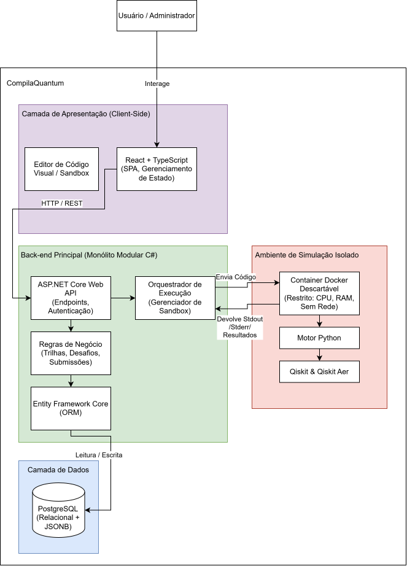

# Compila Quantum

> **Plataforma Web Interativa para Ensino, Prática e Simulação de Computação Quântica**

-512BD4?logo=dotnet&logoColor=white)

---

## Sumário

1. [Descrição do Projeto](#1-descrição-do-projeto)
2. [Problema Abordado e Público-Alvo](#2-problema-abordado-e-público-alvo)
3. [Objetivos do Projeto](#3-objetivos-do-projeto)
4. [Principais Tecnologias e Arquitetura Prevista](#4-principais-tecnologias-e-arquitetura-prevista)
5. [Documentação e Artefatos de Engenharia](#5-documentação-e-artefatos-de-engenharia)
6. [Integrantes da Equipe](#6-integrantes-da-equipe)
7. [Licença](#7-licença)

---

## 1. Descrição do Projeto

O **Compila Quantum** é uma plataforma web educacional e laboratório virtual projetado para tornar o aprendizado de **Computação Quântica** acessível, progressivo e prático.

A plataforma integra, em um único ambiente web, uma **Trilha de Aprendizagem Teórica** estruturada hierarquicamente (`Módulo → Capítulo → Estudo`), **Exercícios Práticos** vinculados diretamente aos conceitos recém-estudados, um catálogo de **Desafios Progressivos** nivelados por dificuldade e com estimativa de tempo, além de um **Modo Livre (Sandbox)** para experimentação aberta sem requisitos obrigatórios de conclusão.

No núcleo da experiência interativa, o usuário pode construir, modificar e simular circuitos quânticos tanto de forma visual — utilizando portas lógicas com **arrastar e soltar (*drag-and-drop*)** — quanto por meio de um **editor de código Python/Qiskit**. Cada execução é processada com segurança em um ambiente isolado e atualiza reativamente o **Console de Execução**, a **Esfera de Bloch** e os **Gráficos de Resultados Probabilísticos / Vetores de Estado**. Para sustentar a motivação contínua do estudante, a plataforma contabiliza sua **Ofensiva Diária (`day_streak`)**, estatísticas de desempenho, histórico de submissões e um calendário anual de frequência diária (*heatmap* no estilo do GitHub).

---

## 2. Problema Abordado e Público-Alvo

### Contexto do Problema

O ensino e a prática da Computação Quântica enfrentam três grandes barreiras identificadas durante o levantamento de requisitos do projeto:

1. **Alta Barreira de Abstração Matemática e Teórica:** Estudantes de tecnologia e programadores iniciantes encontram dificuldade em compreender fenômenos quânticos (como superposição, interferência e emaranhamento) quando apresentados apenas de forma teórica e algébrica, sem uma sequência clara de estudos e sem visualizar imediatamente o efeito prático de cada operação sobre os qubits.
2. **Escassez de Curadoria Científica e Sessões Rápidas de Prática:** Professores universitários e pesquisadores dispõem de rotinas intensas e carecem de uma plataforma confiável — com materiais didáticos acompanhados de **referências científicas explícitas** — que permita tanto indicar atividades niveladas aos alunos quanto exercitar conhecimentos em **desafios curtos (15 a 30 minutos)** sem depender de cursos longos e lineares.
3. **Fragmentação das Ferramentas Atuais no Mercado:** Conforme mapeado na [Análise de Concorrentes](./docs/An%C3%A1lise%20_Concorrentes.md), as plataformas existentes atendem apenas a recortes isolados do problema:

| Funcionalidade | **Compila Quantum** | Black-Opal | PennyLane | QCoder | Quantum Sandbox |
| :--- | :---: | :---: | :---: | :---: | :---: |
| Trilha do aprendizado teórico | ✔️ | ✔️ | ✔️ | ❌ | ✔️ |
| Exercícios práticos e interativos dentro de um LMS | ✔️ | ✔️ | ✔️ | ✔️ | ❌ |
| Utilizar portas lógicas com arrastar e soltar (*drag-and-drop*) | ✔️ | ✔️ | ❌ | ❌ | ❌ |
| Construção e edição de circuitos quânticos | ✔️ | ✔️ | ✔️ | ✔️ | ❌ |
| Visualização da Esfera de Bloch | ✔️ | ✔️ | ❌ | ❌ | ✔️ |
| Gráficos do resultado probabilístico | ✔️ | ❌ | ❌ | ❌ | ❌ |

### Personas Atendidas

O projeto foi modelado a partir das dores, necessidades e desejos de **cinco personas** detalhadas em [Personas e Histórias de Usuário](./docs/Personas_Hist%C3%B3rias.md):

| Persona | Perfil Representado | Principal Necessidade no Compila Quantum |
| :--- | :--- | :--- |
| **O Programador** (*Rodrigo*) | Desenvolvedor com base em computação clássica iniciando na área quântica. | Encontrar uma trilha estruturada do ponto inicial ao avançado, construir/simular circuitos e ter acesso a canal de suporte para dúvidas (`US01`–`US04`). |
| **A Pesquisadora** (*Dra. Gabriela*) | Física e docente universitária com forte base científica e rotina corrida. | Resolver desafios curtos (15–30 min), visualizar estados quânticos e consultar referências científicas confiáveis para indicar aos alunos (`US05`–`US07`). |
| **O Professor** (*Dr. Gael*) | Docente de Matemática/Computação preparando aulas e materiais introdutórios. | Acessar conteúdos fundamentais claramente conectados entre si e exercícios organizados por nível progressivo de dificuldade (`US08`–`US10`). |
| **O Estudante Iniciante** (*Roberto*) | Graduando em Computação sem contato prévio com Física Quântica. | Compreender conceitos abstratos com explicações claras, aplicar a teoria em exercícios imediatos e visualizar graficamente os estados dos qubits (`US11`–`US13`). |
| **O Entusiasta** (*Alberto*) | Autodidata movido por desafios lógicos, experimentação e gamificação. | Explorar livremente no Modo Sandbox com reset em um clique, enfrentar desafios crescentes, repetir tentativas livremente e acompanhar seu progresso (`US14`–`US17`). |

---

## 3. Objetivos do Projeto

### Objetivo Geral

Desenvolver e disponibilizar a plataforma web **Compila Quantum**, oferecendo um ecossistema integrado de ensino teórico, construção visual e programática de circuitos quânticos, simulação segura em containers isolados, avaliação automática de desafios e acompanhamento gamificado de progresso.

### Objetivos Específicos

Os objetivos específicos estruturam os **5 Épicos** do Product Backlog:

1. **Fundação, Autenticação e Gestão de Perfis (`Epic 1`):**
   - Implementar o cadastro de estudantes (`Client`), autenticação segura (`validaLogin`) com controle de sessão e autorização por perfil (`Client` vs `Admin`), além do gerenciamento completo dos dados de perfil e avatar.
2. **Gestão de Conteúdos e Trilha de Aprendizagem Teórica (`Epic 2`):**
   - Disponibilizar o painel administrativo (`UC15`) para manutenção de Módulos, Capítulos e Estudos, e oferecer aos estudantes a visualização estruturada da trilha (`UC01`, `UC08`), leitura de conceitos fundamentais a avançados (`UC09`), materiais didáticos e referências científicas por tópico (`UC02`, `UC05`) e acesso ao canal de suporte (`UC04`).
3. **Sandbox Quântico, Simulação Isolada e Visualização de Estados (`Epic 3`):**
   - Construir o Orquestrador de Execução integrado a containers Docker descartáveis com Python/Qiskit Aer; disponibilizar o Modo Livre (*Sandbox*) com reset instantâneo em um clique (`UC14`), o construtor de circuitos via portas *drag-and-drop* e código (`UC03`), e a visualização reativa do console, da Esfera de Bloch e dos gráficos probabilísticos (`UC06`).
4. **Exercícios Práticos, Desafios Progressivos e Avaliação de Submissões (`Epic 4`):**
   - Permitir o gerenciamento administrativo de Exercícios e Desafios (`UC16`), a realização de atividades práticas integradas ao estudo (`UC11`), a listagem de desafios curtos (15–30 min) filtrados por dificuldade com repetição ilimitada (`UC07`, `UC10`, `UC13`) e a avaliação automática das submissões contra o gabarito (`Submission`).
5. **Acompanhamento de Progresso, Ofensiva Diária e Histórico (`Epic 5`):**
   - Apresentar indicadores visuais e percentuais de conclusão na trilha e nos desafios (`UC12`), contabilizar automaticamente a ofensiva de dias consecutivos (`day_streak`), exibir o painel de conquistas, o histórico detalhado de submissões e o calendário anual de atividades (*heatmap* estilo GitHub) no perfil do estudante.

---

## 4. Principais Tecnologias e Arquitetura Prevista

A plataforma segue uma arquitetura cliente-servidor em **Monólito Modular** para o núcleo de regras de negócio, combinada a um **Ambiente Isolado de Execução (Sandbox)** exclusivo para o processamento dos códigos e circuitos quânticos submetidos.

### Fluxos de Comunicação da Arquitetura

- **Fluxo Convencional (Trilha, Perfil, Progresso e Administração):**
  `Usuário → React/TypeScript (SPA) → ASP.NET Core Web API → PostgreSQL`
- **Fluxo de Simulação e Avaliação Quântica (Sandbox, Exercícios e Desafios):**
  `Usuário → React/TypeScript (SPA) → ASP.NET Core Web API → Orquestrador de Execução → Container Docker Isolado (Python / Qiskit & Qiskit Aer) → Resultado JSON → API → Visualização Reativa no SPA`

### Stack Tecnológica por Camada

| Camada | Tecnologias Previstas | Papel e Justificativa Técnica |
| :--- | :--- | :--- |
| **Front-end (Apresentação)** | **React** + **TypeScript** | Arquitetura baseada em componentes reutilizáveis e gerenciamento reativo de estado, atualizando o console, a Esfera de Bloch e os gráficos probabilísticos após cada simulação sem recarregar a página. Tipagem estática para manipulação segura dos DTOs retornados pela API. |
| **Back-end (Núcleo de Negócio)** | **C#** + **ASP.NET Core Web API** | Monólito modular que centraliza autenticação e autorização (`Client` e `Admin`), regras de domínio, CRUD de conteúdos/exercícios/desafios, avaliação de submissões, cálculo de progresso/ofensiva e orquestração assíncrona das simulações. |
| **Banco de Dados e ORM** | **PostgreSQL** + **Entity Framework Core** | Persistência relacional com integridade referencial estrita para as 7 entidades do domínio (`users`, `modules`, `chapter`, `studies`, `exercises`, `challenges`, `submissions`), versionamento de esquema via *Migrations* e suporte complementar a `JSON/JSONB` para metadados de estado quântico. |
| **Motor de Simulação Quântica** | **Python** + **Qiskit** & **Qiskit Aer** | Processamento científico especializado de qubits, portas lógicas, medições, contagens probabilísticas e vetores de estado, serializando amplitudes complexas (pares de valores real e imaginário) e coordenadas da Esfera de Bloch em JSON estruturado para a API. |
| **Isolamento e Segurança do Sandbox** | **Docker** (Containers Efêmeros) | Como o código submetido pelo usuário é entrada não confiável, cada simulação roda fora do processo da API em um container descartável com versão controlada de Python/Qiskit, limites de CPU e RAM, *timeout* máximo de execução (`runtime`), usuário sem privilégios (*non-root*) e sem acesso à rede. |

---

## 5. Documentação e Artefatos de Engenharia

Todo o levantamento de requisitos, modelagem arquitetural e planejamento ágil encontra-se documentado no repositório:

- **Descoberta de Produto e Requisitos:**
  - [Análise de Concorrentes](./docs/An%C3%A1lise%20_Concorrentes.md)
  - [Personas e Histórias de Usuário](./docs/Personas_Hist%C3%B3rias.md)
  - [Diagrama de Casos de Uso (UML)](./docs/CasoDeUso.drawio.svg)
- **Modelagem e Arquitetura de Software:**
  - [Arquitetura e Tecnologias Previstas para Implementação](./docs/Arquitetura_e_Tecnologias_Compila_Quantum.md)
  - [Diagrama de Arquitetura](./docs/DiagramaArquitetura.drawio.svg)
  - [Diagrama de Classes do Domínio (UML)](./docs/Classes.drawio.svg)
  - [Diagrama Entidade-Relacionamento (DER)](./docs/DER.md)
- **Planejamento e Gestão do Projeto:**
  - [Project Model Canvas — Quadro Visual (Mermaid)](./docs/PMC.md)
  - [Project Model Canvas — Documento Detalhado](./_bmad-output/planning-artifacts/project-model-canvas.md)
  - [Detalhamento de Épicos, Requisitos e User Stories (Product Backlog)](./_bmad-output/planning-artifacts/epics.md)

---

## 6. Integrantes da Equipe

- **Felipe & Ramonys**

---

## 7. Licença

Este projeto está licenciado sob a licença MIT — consulte o arquivo [LICENSE](./LICENSE) para mais detalhes.
