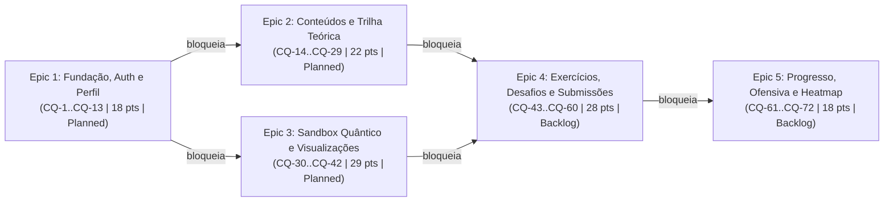

# Product Backlog Inicial — Compila Quantum

> **Documento Oficial de Engenharia de Produto e Requisitos (`Product Backlog Inicial`)**
> - **Projeto:** Compila Quantum — Plataforma Web Educacional e Laboratório Virtual de Computação Quântica
> - **Time no Linear:** `compila-quantum` (Chave: `CQ`)
> - **Escopo Consolidado:** 5 Épicos (Projects) · 22 User Stories (Parent Issues) · 50 Sub-tarefas Técnicas (Sub-issues) · **72 Issues Totais (`CQ-1` a `CQ-72`)**
> - **Orçamento Total de Esforço:** **115 Story Points** (115 pts distribuídos nas 22 Stories = 115 pts distribuídos nas 50 Sub-issues)
> - **Horizonte de Entrega (MVP):** 1 Semestre Letivo (4 Marcos Evolutivos `M1` a `M4`)

---

## Sumário

1. [Visão Geral e Estrutura do Sistema de Backlog](#1-visão-geral-e-estrutura-do-sistema-de-backlog)
2. [Taxonomia, Estados, Prioridades e Labels no Linear](#2-taxonomia-estados-prioridades-e-labels-no-linear)
3. [Inventário Completo de Requisitos (FR, NFR, ARCH, UX-DR)](#3-inventário-completo-de-requisitos-fr-nfr-arch-ux-dr)
4. [Matriz de Rastreabilidade Completa (Personas ↔ US ↔ UC ↔ FR ↔ Linear)](#4-matriz-de-rastreabilidade-completa-personas--us--uc--fr--linear)
5. [Roadmap de Épicos, Dependências e Distribuição de Esforço](#5-roadmap-de-épicos-dependências-e-distribuição-de-esforço)
6. [Índice Mestre das 72 Issues do Backlog (`CQ-1` a `CQ-72`)](#6-índice-mestre-das-72-issues-do-backlog-cq-1-a-cq-72)
7. [Detalhamento Completo por Épico, Story e Sub-issues](#7-detalhamento-completo-por-épico-story-e-sub-issues)
   - [7.1 Epic 1: Fundação da Plataforma, Autenticação e Perfil de Usuários (`CQ-1` a `CQ-13`)](#71-epic-1-fundação-da-plataforma-autenticação-e-perfil-de-usuários)
   - [7.2 Epic 2: Gestão de Conteúdos e Trilha de Aprendizagem Teórica (`CQ-14` a `CQ-29`)](#72-epic-2-gestão-de-conteúdos-e-trilha-de-aprendizagem-teórica)
   - [7.3 Epic 3: Sandbox Quântico, Simulação Isolada e Visualização de Estados (`CQ-30` a `CQ-42`)](#73-epic-3-sandbox-quântico-simulação-isolada-e-visualização-de-estados)
   - [7.4 Epic 4: Exercícios Práticos, Desafios Progressivos e Avaliação de Submissões (`CQ-43` a `CQ-60`)](#74-epic-4-exercícios-práticos-desafios-progressivos-e-avaliação-de-submissões)
   - [7.5 Epic 5: Acompanhamento de Progresso, Ofensiva Diária e Histórico do Estudante (`CQ-61` a `CQ-72`)](#75-epic-5-acompanhamento-de-progresso-ofensiva-diária-e-histórico-do-estudante)
8. [Notas de Alinhamento de Modelagem de Dados (`DER` ↔ Implementação)](#8-notas-de-alinhamento-de-modelagem-de-dados-der--implementação)

---

## 1. Visão Geral e Estrutura do Sistema de Backlog

O **Product Backlog Inicial** do projeto **Compila Quantum** foi concebido para garantir rastreabilidade ponta a ponta entre os artefatos de concepção acadêmica e a execução de engenharia de software no **Linear**:

- **Documentos de Origem (Fontes do Backlog):**
  - `docs/Personas_Histórias.md` — 5 Personas (*O Programador*, *A Pesquisadora*, *O Professor*, *O Estudante Iniciante*, *O Entusiasta*) e 17 User Stories de negócio (`US01` a `US17`);
  - `docs/CasoDeUso.drawio.svg` — 16 Casos de Uso (`UC01` a `UC16`) cobrindo os atores `Estudante (Client)` e `Administrador (Admin)`, incluindo a relação obrigatória `Executar circuitos quânticos <<include>> Visualizar resultados da simulação`;
  - `docs/Classes.drawio.svg` — Modelo de domínio orientado a objetos (`User`, `Client`, `Admin`, `Module`, `Chapter`, `Study`, `Exercises`, `Challenge`, `Submission`) e seus métodos de negócio;
  - `docs/DER.md` — Esquema relacional de 7 tabelas no PostgreSQL (`users`, `modules`, `chapter`, `studies`, `exercises`, `challenges`, `submissions`);
  - `docs/Arquitetura_e_Tecnologias_Compila_Quantum.md` & `docs/DiagramaArquitetura.drawio.svg` — Arquitetura em Monólito Modular (`React/TypeScript` → `ASP.NET Core Web API` + `EF Core` → `PostgreSQL`) com isolamento do motor quântico em container descartável (`Docker` + `Python / Qiskit & Qiskit Aer`);
  - `docs/Análise _Concorrentes.md` — Matriz comparativa frente a *Black-Opal*, *PennyLane*, *QCoder* e *Quantum Sandbox*;
  - `docs/PMC.md` — Project Model Canvas e cronograma em 4 marcos semestrais (`M1` a `M4`).

### Estrutura Hierárquica em 3 Níveis no Linear

1. **Nível 1 — Épicos (`Projects` no Linear):** 5 grandes pacotes de entrega funcional e arquitetural (`Epic 1` a `Epic 5`), conectados por dependências explícitas de roadmap.
2. **Nível 2 — User Stories (`Parent Issues` no Linear):** 22 histórias de usuário (`Story 1.1` a `Story 5.4`), escritas no formato padrão (*As a / I want / So that*) com Critérios de Aceitação em BDD (*Given / When / Then*) e estimadas em Story Points (escala Fibonacci: `2`, `3`, `5`, `8`).
3. **Nível 3 — Sub-tarefas Técnicas (`Sub-issues` no Linear):** 50 tarefas técnicas (`[DB/EF Core]`, `[API]`, `[SPA]`, `[Sandbox/Docker]`) vinculadas às suas respectivas Parent Stories, detalhando o **Objetivo Técnico**, os **Critérios de Implementação** por camada e a fração exata de Story Points da Story mãe.

---

## 2. Taxonomia, Estados, Prioridades e Labels no Linear

### 2.1 Fluxo de Estados (Workflow States)

| Ordem | Estado no Linear | Tipo (`state.type`) | Cor | Uso no Ciclo de Vida da Issue |
| :---: | :--- | :--- | :---: | :--- |
| 1 | **Backlog** | `backlog` | `#BEC2C8` | Estado inicial de todas as 72 issues do Product Backlog Inicial aguardando puxada para o ciclo/sprint. |
| 2 | **Todo** | `unstarted` | `#E2E2E2` | Issue priorizada e pronta para iniciar desenvolvimento no ciclo atual. |
| 3 | **In Progress** | `started` | `#F2C94C` | Issue em desenvolvimento ativo por um integrante da equipe. |
| 4 | **In Review** | `started` | `#0F783C` | Código em revisão de Pull Request, validação de critérios BDD e testes integrados. |
| 5 | **Done** | `completed` | `#5E6AD2` | Critérios de aceitação e implementação 100% atendidos e homologados. |
| 6 | **Canceled** | `canceled` | `#95A2B3` | Item descartado por mudança de escopo. |
| 7 | **Duplicate** | `duplicate` | `#95A2B3` | Item encerrado por duplicidade. |

### 2.2 Escala de Prioridades

| Prioridade Linear | Código | Critério de Atribuição no Projeto | Qtd. Stories | Qtd. Sub-issues | Total Issues |
| :--- | :---: | :--- | :---: | :---: | :---: |
| **Urgent** | `1` | Fundação arquitetural bloqueante (`Epic 1`), motor de isolamento Docker/Qiskit (`Story 3.1`) e motor de avaliação de submissões (`Story 4.3`). | 5 | 13 | **18** |
| **High** | `2` | Funcionalidades centrais do MVP: Perfil (`Story 1.4`), Trilha e CRUD de Conteúdos (`Story 2.1–2.4`), Sandbox/Drag-and-Drop/Bloch (`Story 3.2–3.4`) e Exercícios/Desafios (`Story 4.1, 4.2, 4.4, 4.5`). | 12 | 28 | **40** |
| **Medium** | `3` | Canal de suporte (`Story 2.5`) e camada de gamificação, estatísticas, ofensiva diária e *heatmap* (`Epic 5`: `Story 5.1–5.4`). | 5 | 9 | **14** |
| **Total** | — | — | **22** | **50** | **72** |

### 2.3 Sistema de Labels (Categorias Técnicas, Perfis e Tipo)

| Label no Linear | Cor Hex | Categoria | Descrição e Aplicação |
| :--- | :---: | :--- | :--- |
| `User Story` | `#0F783C` | Tipo de Item | Aplicada exclusivamente às **22 Parent Issues** (`Story 1.1` a `Story 5.4`). |
| `Tech Sub-task` | `#6B7280` | Tipo de Item | Aplicada exclusivamente às **50 Sub-issues** técnicas de implementação. |
| `Feature` | `#BB87FC` | Natureza | Aplicada às 22 User Stories de entrega de valor funcional ao produto. |
| `Database (PostgreSQL/EF)` | `#3B82F6` | Camada Técnica | Modelagem relacional, entidades EF Core, *Migrations* PostgreSQL, índices e *Seed*. |
| `Backend (ASP.NET Core)` | `#8B5CF6` | Camada Técnica | Endpoints REST, regras de negócio, autenticação JWT, autorização e serviços em C# / .NET. |
| `Frontend (React/TS)` | `#06B6D4` | Camada Técnica | Interface SPA em React + TypeScript, gerenciamento de estado reativo e rotas. |
| `Quantum Sandbox (Docker/Qiskit)` | `#F59E0B` | Camada Técnica | Orquestrador de containers Docker descartáveis e motor Python / Qiskit & Qiskit Aer. |
| `UX & Visualization` | `#F97316` | Experiência / UI | Componentes visuais interativos, Esfera de Bloch, gráficos probabilísticos, *Heatmap* e *Drag-and-Drop*. |
| `Security & NFR` | `#EF4444` | Qualidade / NFR | Requisitos Não-Funcionais, hash de senha, JWT/RBAC, isolamento *non-root*, sem rede e *timeout*. |
| `Role: Client` | `#10B981` | Ator / Perfil | Funcionalidades voltadas ao Estudante (*Programador*, *Pesquisadora*, *Professor*, *Iniciante*, *Entusiasta*). |
| `Role: Admin` | `#EC4899` | Ator / Perfil | Funcionalidades voltadas ao Administrador/Curador da plataforma (`UC15`, `UC16`). |
| `Bug` / `Improvement` | `#EB5757` / `#4EA7FC` | Manutenção | Reservadas para defeitos e melhorias identificados durante os ciclos de implementação. |

---

## 3. Inventário Completo de Requisitos (FR, NFR, ARCH, UX-DR)

### 3.1 Requisitos Funcionais (`FR1` a `FR20`)

| ID | Requisito Funcional | Casos de Uso / User Stories | Épico | Stories no Linear |
| :---: | :--- | :--- | :---: | :--- |
| **FR1** | **Autenticação e Controle de Acesso:** Permitir cadastro, login (`validaLogin`) e controle de sessão/autorização por perfil (`Client` vs `Admin`), gerenciando `email`, `nickname` e credenciais. | Diagrama de Classes (`User`, `Client`, `Admin`) | Epic 1 | `CQ-1`, `CQ-5`, `CQ-8` |
| **FR2** | **Gestão de Perfil do Estudante:** Permitir ao estudante (`Client`) visualizar e editar seus dados (`first_name`, `last_name`, `nickname`, `email`, `job` e foto de perfil `image`). | Diagrama de Classes (`Client`) | Epic 1 | `CQ-11` |
| **FR3** | **CRUD de Módulos:** Permitir ao `Admin` criar, listar, atualizar e excluir Módulos (`modules`: `title`, `subtitle`, `topic`). | `UC15` | Epic 2 | `CQ-14` |
| **FR4** | **CRUD de Capítulos:** Permitir ao `Admin` criar, listar, atualizar e excluir Capítulos (`chapter`: `id_modules`, `title`, `subtitle`). | `UC15` | Epic 2 | `CQ-14` |
| **FR5** | **CRUD de Estudos e Referências:** Permitir ao `Admin` criar, listar, atualizar e excluir Estudos teóricos (`studies`: `id_chapter`, `title`, `content` rico com materiais didáticos e referências científicas). | `UC15` | Epic 2 | `CQ-18` |
| **FR6** | **CRUD de Exercícios:** Permitir ao `Admin` criar, listar, atualizar e excluir Exercícios práticos vinculados a um estudo (`exercises`: `id_studie`, `title`, `description`, `type`, `answers`). | `UC16` | Epic 4 | `CQ-43` |
| **FR7** | **CRUD de Desafios:** Permitir ao `Admin` criar, listar, atualizar e excluir Desafios (`challenges`: `title`, `difficulty`, `type`, `statement`, `answers` e estimativa de tempo). | `UC16` | Epic 4 | `CQ-47` |
| **FR8** | **Visualização da Trilha e Relações de Conteúdo:** Apresentar a trilha de estudos estruturada hierarquicamente (`Module` → `Chapter` → `Study`), evidenciando o ponto inicial, a sequência lógica e a relação entre os conceitos. | `UC01`, `UC08` / `US01`, `US08` | Epic 2 | `CQ-22` |
| **FR9** | **Leitura de Conceitos Fundamentais a Avançados:** Exibir os conteúdos teóricos (`studies.content`) com explicações claras dos conceitos fundamentais da Computação Quântica como base para temas avançados. | `UC09` / `US09`, `US11` | Epic 2 | `CQ-25` |
| **FR10** | **Materiais Didáticos e Referências Científicas:** Exibir materiais didáticos complementares por tópico e referências científicas organizadas e associadas ao conteúdo estudado. | `UC02`, `UC05` / `US02`, `US05` | Epic 2 | `CQ-25` |
| **FR11** | **Suporte e Canal de Dúvidas:** Indicar e disponibilizar acesso direto ao canal/recurso de suporte para esclarecimento de dúvidas durante o aprendizado. | `UC04` / `US04` | Epic 2 | `CQ-28` |
| **FR12** | **Atividades Práticas Vinculadas ao Estudo:** Disponibilizar e avaliar exercícios práticos (`exercises`) diretamente associados ao conteúdo teórico recém-estudado. | `UC11` / `US11` | Epic 4 | `CQ-55` |
| **FR13** | **Organização Progressiva por Nível de Dificuldade:** Organizar e filtrar exercícios e desafios por nível crescente de dificuldade (`difficulty`) e tipo (`type`), indicando o nível atual do estudante, etapas posteriores e conteúdos relacionados. | `UC10` / `US10`, `US16` | Epic 4 | `CQ-58` |
| **FR14** | **Resolução de Desafios Curtos e Independentes:** Permitir selecionar e resolver desafios avulsos (`challenges`) com indicação prévia de tempo estimado (sessões rápidas de 15–30 min), sem exigir a conclusão prévia de uma trilha longa. | `UC07` / `US07` | Epic 4 | `CQ-58` |
| **FR15** | **Reiniciar e Refazer Desafios:** Permitir repetir qualquer exercício ou desafio não concluído (ou já concluído) quantas vezes desejar, reiniciando a atividade em seu estado inicial. | `UC13` / `US15` | Epic 4 | `CQ-58` |
| **FR16** | **Registro e Avaliação de Submissões:** Persistir cada submissão realizada (`submissions`: `id_user`, `id_exercises` ou `id_challenges`, `code`, `date`, `runtime`, `result`), comparando a saída da simulação com o gabarito (`answers`). | Diagrama de Classes (`Submission`) | Epic 4 | `CQ-51` |
| **FR17** | **Progresso, Ofensiva, Heatmap Diário e Conquistas:** Acompanhar e exibir o progresso atualizado do estudante após cada atividade concluída, incluindo ofensiva diária (`day_streak`), calendário gráfico de frequência diária (*heatmap* estilo GitHub no perfil), módulos concluídos (`modulesSolved`), desafios resolvidos (`challengesSolved`), total de submissões (`submissionSended`) e histórico de submissões. | `UC12` / `US14` | Epic 5 | `CQ-61`, `CQ-64`, `CQ-67`, `CQ-70` |
| **FR18** | **Experimentação no Modo Livre / Sandbox:** Disponibilizar ambiente Sandbox livre (sem requisitos de avaliação/conclusão) para testar interações quânticas e resetar instantaneamente para o estado inicial com um único clique. | `UC14` / `US17` | Epic 3 | `CQ-34` |
| **FR19** | **Construir e Simular Circuitos Quânticos:** Permitir construir, modificar e simular circuitos quânticos utilizando portas lógicas com arrastar e soltar (*drag-and-drop*) e/ou editor de código, tanto no Sandbox quanto nos exercícios e desafios. | `UC03` / `US03`, `US12` | Epic 3 | `CQ-30`, `CQ-34`, `CQ-37` |
| **FR20** | **Visualizar Representação Gráfica dos Estados Quânticos:** Toda execução de circuito (`<<include>>`) deve retornar e atualizar visualizações gráficas do estado quântico resultante — incluindo Esfera de Bloch e gráficos de resultado probabilístico / vetores de estado — além do console de execução. | `UC06` / `US06`, `US13` | Epic 3 | `CQ-30`, `CQ-40` |

### 3.2 Requisitos Não-Funcionais (`NFR1` a `NFR6`)

| ID | Requisito Não-Funcional | Descrição Técnica | Issues Associadas |
| :---: | :--- | :--- | :--- |
| **NFR1** | **Isolamento em Container Descartável** | Códigos/circuitos submetidos são entradas não confiáveis e devem ser executados fora do processo da API, em containers Docker descartáveis (`--rm`). | `CQ-30`, `CQ-31`, `CQ-32`, `CQ-51` |
| **NFR2** | **Restrições de Segurança do Sandbox** | Cada container deve operar com limites de CPU e RAM, *timeout* de execução (registrando `DOUBLE runtime`), usuário sem privilégios (*non-root*) e sem acesso à rede (`--network none`). | `CQ-30`, `CQ-31`, `CQ-32` |
| **NFR3** | **Encapsulamento da Camada de Dados e Simulação** | O front-end (SPA) comunica-se exclusivamente via `HTTP / REST` com a ASP.NET Core Web API; nenhum acesso direto ao PostgreSQL ou ao Docker é permitido. | `CQ-1`, `CQ-2`, `CQ-5` |
| **NFR4** | **Integridade Relacional** | O esquema PostgreSQL deve impor chaves primárias, estrangeiras e restrições de unicidade conforme o modelo relacional (`users`, `modules`, `chapter`, `studies`, `exercises`, `challenges`, `submissions`). | `CQ-1`, `CQ-2`, `CQ-14`, `CQ-15`, `CQ-18`, `CQ-19`, `CQ-43`, `CQ-44`, `CQ-47`, `CQ-48`, `CQ-51`, `CQ-52` |
| **NFR5** | **Reatividade de Interface** | A execução de circuitos no Sandbox, exercícios e desafios deve atualizar console, Esfera de Bloch e gráficos probabilísticos de forma reativa no SPA sem recarregar a página. | `CQ-34`, `CQ-35`, `CQ-36`, `CQ-37`, `CQ-40`, `CQ-41`, `CQ-42` |
| **NFR6** | **Orquestração Assíncrona** | O Orquestrador de Execução em C# deve despachar e aguardar as simulações Python/Qiskit de maneira assíncrona (`async/await`). | `CQ-30`, `CQ-32`, `CQ-51`, `CQ-53` |

### 3.3 Requisitos Arquiteturais (`ARCH-1` a `ARCH-4`) e de UX (`UX-DR1` a `UX-DR5`)

| ID | Categoria | Especificação | Issues Principais |
| :---: | :--- | :--- | :--- |
| **ARCH-1** | Front-end SPA | React + TypeScript com gerenciamento reativo de estado, construtor visual de circuitos (*drag-and-drop*), editor de código, visualizador de Esfera de Bloch e gráficos probabilísticos. | `CQ-4`, `CQ-7`, `CQ-13`, `CQ-34`, `CQ-37`, `CQ-40` |
| **ARCH-2** | Back-end Monólito Modular | C# / ASP.NET Core Web API contendo Endpoints REST, Autenticação/Autorização JWT, Regras de Negócio, Entity Framework Core (ORM com *Migrations*) e Orquestrador de Execução. | `CQ-2`, `CQ-3`, `CQ-6`, `CQ-9`, `CQ-32`, `CQ-53` |
| **ARCH-3** | Banco de Dados PostgreSQL | Implementação das 7 tabelas relacionais (`users`, `modules`, `chapter`, `studies`, `exercises`, `challenges`, `submissions`) + uso complementar de JSON/JSONB para metadados e estado quântico. | `CQ-2`, `CQ-15`, `CQ-19`, `CQ-44`, `CQ-48`, `CQ-52`, `CQ-71` |
| **ARCH-4** | Motor de Simulação Quântica | Container Docker com Python + Qiskit & Qiskit Aer, serializando `stdout`, `stderr`, `runtime`, `result`, probabilidades de medição e amplitudes complexas (pares real/imaginário). | `CQ-30`, `CQ-31`, `CQ-32`, `CQ-33`, `CQ-53` |
| **UX-DR1** | Construtor Visual + Editor | Interface interativa para montagem de circuitos arrastando portas lógicas sobre fios de qubits, integrada e sincronizada ao editor de código Qiskit. | `CQ-34`, `CQ-35`, `CQ-37`, `CQ-38`, `CQ-39`, `CQ-56` |
| **UX-DR2** | Visualizador Esfera de Bloch | Componente gráfico interativo que exibe o vetor de estado dos qubits na Esfera de Bloch atualizado a cada execução. | `CQ-40`, `CQ-41`, `CQ-56` |
| **UX-DR3** | Gráficos Probabilísticos | Componente de visualização de histogramas/gráficos das probabilidades de medição e amplitudes complexas do estado quântico. | `CQ-40`, `CQ-42`, `CQ-56` |
| **UX-DR4** | Console de Execução Integrado | Painel reativo exibindo `stdout`, `stderr`, tempo de execução (`runtime`) e mensagens de erro/validação da simulação. | `CQ-34`, `CQ-36`, `CQ-56` |
| **UX-DR5** | Indicadores, Badges e Heatmap | Badges de nível de dificuldade, tempo estimado (15–30 min), ofensiva (`day_streak`), grade anual de atividades (*heatmap* estilo GitHub) e barras de conclusão. | `CQ-22`, `CQ-24`, `CQ-58`, `CQ-59`, `CQ-61`, `CQ-63`, `CQ-64`, `CQ-66`, `CQ-70`, `CQ-72` |

---

## 4. Matriz de Rastreabilidade Completa (Personas ↔ US ↔ UC ↔ FR ↔ Linear)

| Persona / Ator | User Story Original (`Personas_Histórias.md`) | Caso de Uso (`CasoDeUso.drawio.svg`) | Req. Funcional | Story no Backlog (Linear) | Sub-issues Técnicas no Linear |
| :--- | :--- | :--- | :---: | :--- | :--- |
| **Client / Admin** | *(Fundação de Domínio e Segurança)* | Login / Controle de Acesso (`validaLogin`) | `FR1` | `Story 1.1 (CQ-1)` `Story 1.2 (CQ-5)` `Story 1.3 (CQ-8)` | `CQ-2`, `CQ-3`, `CQ-4` `CQ-6`, `CQ-7` `CQ-9`, `CQ-10` |
| **Client** | *(Gestão de Identidade do Estudante)* | Manter Perfil do Usuário (`Client`) | `FR2` | `Story 1.4 (CQ-11)` | `CQ-12`, `CQ-13` |
| **Admin** | *(Curadoria Pedagógica)* | **UC15** — Gerenciar conteúdos e referências | `FR3`, `FR4`, `FR5` | `Story 2.1 (CQ-14)` `Story 2.2 (CQ-18)` | `CQ-15`, `CQ-16`, `CQ-17` `CQ-19`, `CQ-20`, `CQ-21` |
| **O Programador** (*Rodrigo*) | **US01** — Sequência organizada de tópicos com ponto inicial | **UC01** — Visualizar trilha de estudos | `FR8` | `Story 2.3 (CQ-22)` | `CQ-23`, `CQ-24` |
| **O Programador** (*Rodrigo*) | **US02** — Materiais didáticos relacionados aos conteúdos | **UC02** — Acessar materiais didáticos por tópico | `FR10` | `Story 2.4 (CQ-25)` | `CQ-26`, `CQ-27` |
| **O Programador** (*Rodrigo*) | **US03** — Construir, simular e alterar circuitos na prática | **UC03** — Construir e simular circuitos quânticos | `FR19` | `Story 3.1 (CQ-30)` `Story 3.2 (CQ-34)` `Story 3.3 (CQ-37)` | `CQ-31`, `CQ-32`, `CQ-33` `CQ-35`, `CQ-36` `CQ-38`, `CQ-39` |
| **O Programador** (*Rodrigo*) | **US04** — Meio de buscar ajuda para dúvidas de estudo | **UC04** — Solicitar suporte / acessar canal de dúvidas | `FR11` | `Story 2.5 (CQ-28)` | `CQ-29` |
| **A Pesquisadora** (*Gabriela*) | **US05** — Materiais didáticos com referências científicas | **UC05** — Consultar referências científicas | `FR10` | `Story 2.4 (CQ-25)` | `CQ-26`, `CQ-27` |
| **A Pesquisadora** (*Gabriela*) | **US06** — Visualizar representações dos estados quânticos | **UC06** — Visualizar representação gráfica dos estados | `FR20` | `Story 3.4 (CQ-40)` | `CQ-41`, `CQ-42` |
| **A Pesquisadora** (*Gabriela*) | **US07** — Resolver desafios curtos com estimativa de tempo | **UC07** — Resolver desafios curtos | `FR14` | `Story 4.5 (CQ-58)` | `CQ-59`, `CQ-60` |
| **O Professor** (*Gael*) | **US08** — Conteúdos estruturados com relação clara entre temas | **UC08** — Explorar estrutura e relações dos conteúdos | `FR8` | `Story 2.3 (CQ-22)` | `CQ-23`, `CQ-24` |
| **O Professor** (*Gael*) | **US09** — Compreender conceitos fundamentais como base | **UC09** — Estudar conceitos fundamentais | `FR9` | `Story 2.4 (CQ-25)` | `CQ-26`, `CQ-27` |
| **O Professor** (*Gael*) | **US10** — Exercícios organizados de forma progressiva por nível | **UC10** — Selecionar exercícios por nível de dificuldade | `FR13` | `Story 4.5 (CQ-58)` | `CQ-59`, `CQ-60` |
| **O Estudante Iniciante** (*Roberto*) | **US11** — Aprender conceitos claros e aplicar em prática | **UC09** + **UC11** — Realizar atividades práticas | `FR9`, `FR12` | `Story 2.4 (CQ-25)` `Story 4.4 (CQ-55)` | `CQ-26`, `CQ-27` `CQ-56`, `CQ-57` |
| **O Estudante Iniciante** (*Roberto*) | **US12** — Criar, modificar e simular circuitos vendo efeito | **UC03** — Construir e simular circuitos quânticos | `FR19` | `Story 3.2 (CQ-34)` `Story 3.3 (CQ-37)` | `CQ-35`, `CQ-36` `CQ-38`, `CQ-39` |
| **O Estudante Iniciante** (*Roberto*) | **US13** — Visualizar graficamente alteração de estado dos qubits | **UC06** — Visualizar representação gráfica dos estados | `FR20` | `Story 3.4 (CQ-40)` | `CQ-41`, `CQ-42` |
| **O Entusiasta** (*Alberto*) | **US14** — Acompanhar avanço ao concluir atividades e desafios | **UC12** — Acompanhar progresso nos desafios e estudos | `FR17` | `Story 5.1 (CQ-61)` `Story 5.2 (CQ-64)` `Story 5.3 (CQ-67)` `Story 5.4 (CQ-70)` | `CQ-62`, `CQ-63` `CQ-65`, `CQ-66` `CQ-68`, `CQ-69` `CQ-71`, `CQ-72` |
| **O Entusiasta** (*Alberto*) | **US15** — Tentar novamente desafios não concluídos (reset) | **UC13** — Reiniciar e tentar novamente um desafio | `FR15` | `Story 4.5 (CQ-58)` | `CQ-59`, `CQ-60` |
| **O Entusiasta** (*Alberto*) | **US16** — Desafios com níveis crescentes de dificuldade | **UC10** — Selecionar exercícios por nível de dificuldade | `FR13` | `Story 4.5 (CQ-58)` | `CQ-59`, `CQ-60` |
| **O Entusiasta** (*Alberto*) | **US17** — Ambiente livre estilo Sandbox com reset em 1 clique | **UC14** — Experimentar livremente no modo Sandbox | `FR18` | `Story 3.2 (CQ-34)` | `CQ-35`, `CQ-36` |
| **Admin** | *(Gestão de Avaliações Práticas)* | **UC16** — Gerenciar exercícios e desafios | `FR6`, `FR7` | `Story 4.1 (CQ-43)` `Story 4.2 (CQ-47)` | `CQ-44`, `CQ-45`, `CQ-46` `CQ-48`, `CQ-49`, `CQ-50` |
| **Sistema / Client** | *(Motor de Avaliação e Persistência de Submissões)* | Submeter solução (`executeCode`, `getAnswer`) | `FR16` | `Story 4.3 (CQ-51)` | `CQ-52`, `CQ-53`, `CQ-54` |

---

## 5. Roadmap de Épicos, Dependências e Distribuição de Esforço

### 5.1 Grafo de Dependências entre Projetos no Linear

### 5.2 Consolidação Quantitativa por Épico

| Épico (Project no Linear) | Status Inicial | Marco Semestral | Faixa de IDs | Stories | Sub-issues | Total de Issues | Story Points | % do Esforço |
| :--- | :---: | :---: | :---: | :---: | :---: | :---: | :---: | :---: |
| **Epic 1:** Fundação da Plataforma, Autenticação e Perfil de Usuários | `Planned` | M1 (Semanas 1–4) | `CQ-1` a `CQ-13` | 4 | 9 | 13 | **18 pts** | 15,7% |
| **Epic 2:** Gestão de Conteúdos e Trilha de Aprendizagem Teórica | `Planned` | M2 (Semanas 5–11) | `CQ-14` a `CQ-29` | 5 | 11 | 16 | **22 pts** | 19,1% |
| **Epic 3:** Sandbox Quântico, Simulação Isolada e Visualização de Estados | `Planned` | M2 (Semanas 5–11) | `CQ-30` a `CQ-42` | 4 | 9 | 13 | **29 pts** | 25,2% |
| **Epic 4:** Exercícios Práticos, Desafios Progressivos e Avaliação de Submissões | `Backlog` | M3 (Semanas 12–15) | `CQ-43` a `CQ-60` | 5 | 13 | 18 | **28 pts** | 24,3% |
| **Epic 5:** Acompanhamento de Progresso, Ofensiva Diária e Histórico do Estudante | `Backlog` | M4 (Semanas 16–20) | `CQ-61` a `CQ-72` | 4 | 8 | 12 | **18 pts** | 15,7% |
| **TOTAL CONSOLIDADO DO BACKLOG** | — | **1 Semestre** | **`CQ-1` a `CQ-72`** | **22** | **50** | **72** | **115 pts** | **100%** |

---

## 6. Índice Mestre das 72 Issues do Backlog (`CQ-1` a `CQ-72`)

| ID | Tipo | Parent | Épico | Título da Issue / Sub-issue | Prioridade | Estimativa | Estado | Labels no Linear |
| :---: | :---: | :---: | :---: | :--- | :---: | :---: | :---: | :--- |
| [CQ-1](https://linear.app/vandevelde/issue/CQ-1/story-11-estrutura-inicial-da-aplicacao-e-cadastro-de-estudante-client) | **Story** | — | Epic 1 | **Story 1.1: Estrutura Inicial da Aplicação e Cadastro de Estudante (Client)** | Urgent | **5 pts** | Backlog | `User Story`, `Feature`, `Database (PostgreSQL/EF)`, `Backend (ASP.NET Core)`, `Frontend (React/TS)`, `Role: Client` |
| [CQ-2](https://linear.app/vandevelde/issue/CQ-2/dbef-core-configurar-solucao-base-net-postgresql-e-migration-inicial) | Sub-issue | `CQ-1` | Epic 1 | [DB/EF Core] Configurar solução base (.NET + PostgreSQL) e Migration inicial da tabela users | Urgent | 2 pts | Backlog | `Tech Sub-task`, `Database (PostgreSQL/EF)`, `Backend (ASP.NET Core)` |
| [CQ-3](https://linear.app/vandevelde/issue/CQ-3/api-implementar-endpoint-post-de-cadastro-de-estudante-client-com-hash) | Sub-issue | `CQ-1` | Epic 1 | [API] Implementar endpoint POST de cadastro de estudante (Client) com hash de senha e validação de unicidade | Urgent | 2 pts | Backlog | `Tech Sub-task`, `Backend (ASP.NET Core)`, `Role: Client`, `Security & NFR` |
| [CQ-4](https://linear.app/vandevelde/issue/CQ-4/spa-setup-inicial-reacttypescript-e-tela-de-cadastro-de-estudante) | Sub-issue | `CQ-1` | Epic 1 | [SPA] Setup inicial React/TypeScript e tela de Cadastro de Estudante integrada à API | Urgent | 1 pts | Backlog | `Tech Sub-task`, `Frontend (React/TS)`, `Role: Client` |
| [CQ-5](https://linear.app/vandevelde/issue/CQ-5/story-12-autenticacao-de-usuario-validalogin-e-gestao-de-sessao) | **Story** | — | Epic 1 | **Story 1.2: Autenticação de Usuário (validaLogin) e Gestão de Sessão** | Urgent | **5 pts** | Backlog | `User Story`, `Feature`, `Backend (ASP.NET Core)`, `Frontend (React/TS)`, `Security & NFR` |
| [CQ-6](https://linear.app/vandevelde/issue/CQ-6/api-implementar-autenticacao-validalogin-com-emissao-de-token-jwt-e) | Sub-issue | `CQ-5` | Epic 1 | [API] Implementar autenticação (validaLogin) com emissão de token JWT e claims (id_users, nickname, role) | Urgent | 3 pts | Backlog | `Tech Sub-task`, `Backend (ASP.NET Core)`, `Security & NFR` |
| [CQ-7](https://linear.app/vandevelde/issue/CQ-7/spa-implementar-tela-de-login-gerenciamento-de-contexto-de-sessaojwt-e) | Sub-issue | `CQ-5` | Epic 1 | [SPA] Implementar tela de Login, gerenciamento de contexto de sessão/JWT e fluxo de Logout | Urgent | 2 pts | Backlog | `Tech Sub-task`, `Frontend (React/TS)` |
| [CQ-8](https://linear.app/vandevelde/issue/CQ-8/story-13-controle-de-acesso-por-perfil-client-vs-admin-e) | **Story** | — | Epic 1 | **Story 1.3: Controle de Acesso por Perfil (Client vs Admin) e Provisionamento de Administrador** | Urgent | **3 pts** | Backlog | `User Story`, `Feature`, `Backend (ASP.NET Core)`, `Frontend (React/TS)`, `Role: Admin`, `Security & NFR` |
| [CQ-9](https://linear.app/vandevelde/issue/CQ-9/apidb-implementar-politicas-de-autorizacao-por-role-client-vs-admin-e) | Sub-issue | `CQ-8` | Epic 1 | [API/DB] Implementar políticas de autorização por Role (Client vs Admin) e Seed seguro de conta Admin | Urgent | 2 pts | Backlog | `Tech Sub-task`, `Backend (ASP.NET Core)`, `Database (PostgreSQL/EF)`, `Role: Admin`, `Security & NFR` |
| [CQ-10](https://linear.app/vandevelde/issue/CQ-10/spa-implementar-route-guards-por-perfil-client-vs-admin-e-tratamento) | Sub-issue | `CQ-8` | Epic 1 | [SPA] Implementar Route Guards por perfil (Client vs Admin) e tratamento de acesso negado (401/403) | Urgent | 1 pts | Backlog | `Tech Sub-task`, `Frontend (React/TS)`, `Role: Admin` |
| [CQ-11](https://linear.app/vandevelde/issue/CQ-11/story-14-visualizacao-e-edicao-de-perfil-do-estudante-client) | **Story** | — | Epic 1 | **Story 1.4: Visualização e Edição de Perfil do Estudante (Client)** | High | **5 pts** | Backlog | `User Story`, `Feature`, `Backend (ASP.NET Core)`, `Frontend (React/TS)`, `Role: Client` |
| [CQ-12](https://linear.app/vandevelde/issue/CQ-12/api-implementar-endpoints-getput-de-perfil-do-estudante-first-name) | Sub-issue | `CQ-11` | Epic 1 | [API] Implementar endpoints GET/PUT de perfil do estudante (first_name, last_name, nickname, email, job, image) | High | 2 pts | Backlog | `Tech Sub-task`, `Backend (ASP.NET Core)`, `Role: Client` |
| [CQ-13](https://linear.app/vandevelde/issue/CQ-13/spa-desenvolver-pagina-de-perfil-com-formulario-de-edicao-reativo-e) | Sub-issue | `CQ-11` | Epic 1 | [SPA] Desenvolver página de Perfil com formulário de edição reativo e upload/validação de avatar | High | 3 pts | Backlog | `Tech Sub-task`, `Frontend (React/TS)`, `Role: Client` |
| [CQ-14](https://linear.app/vandevelde/issue/CQ-14/story-21-gestao-administrativa-de-modulos-e-capitulos-uc15-module-and) | **Story** | — | Epic 2 | **Story 2.1: Gestão Administrativa de Módulos e Capítulos (UC15 — Module & Chapter)** | High | **5 pts** | Backlog | `User Story`, `Feature`, `Database (PostgreSQL/EF)`, `Backend (ASP.NET Core)`, `Frontend (React/TS)`, `Role: Admin` |
| [CQ-15](https://linear.app/vandevelde/issue/CQ-15/dbef-core-criar-entidades-e-migrations-para-as-tabelas-modules-e) | Sub-issue | `CQ-14` | Epic 2 | [DB/EF Core] Criar entidades e Migrations para as tabelas modules e chapter com integridade referencial (1:N) | High | 1 pts | Backlog | `Tech Sub-task`, `Database (PostgreSQL/EF)` |
| [CQ-16](https://linear.app/vandevelde/issue/CQ-16/api-implementar-endpoints-rest-de-crud-administrativo-para-modulos-e) | Sub-issue | `CQ-14` | Epic 2 | [API] Implementar endpoints REST de CRUD administrativo para Módulos e Capítulos (postModule, putModule, postChapter, putChapter, DELETE) | High | 2 pts | Backlog | `Tech Sub-task`, `Backend (ASP.NET Core)`, `Role: Admin` |
| [CQ-17](https://linear.app/vandevelde/issue/CQ-17/spa-construir-painel-administrativo-para-listagem-criacao-ordenacao) | Sub-issue | `CQ-14` | Epic 2 | [SPA] Construir painel administrativo para listagem, criação, ordenação por topic, edição e exclusão de Módulos e Capítulos | High | 2 pts | Backlog | `Tech Sub-task`, `Frontend (React/TS)`, `Role: Admin` |
| [CQ-18](https://linear.app/vandevelde/issue/CQ-18/story-22-gestao-administrativa-de-estudos-materiais-didaticos-e) | **Story** | — | Epic 2 | **Story 2.2: Gestão Administrativa de Estudos, Materiais Didáticos e Referências Científicas (UC15 — Study)** | High | **5 pts** | Backlog | `User Story`, `Feature`, `Database (PostgreSQL/EF)`, `Backend (ASP.NET Core)`, `Frontend (React/TS)`, `Role: Admin` |
| [CQ-19](https://linear.app/vandevelde/issue/CQ-19/dbef-core-criar-entidade-e-migration-da-tabela-studies-id-studies-id) | Sub-issue | `CQ-18` | Epic 2 | [DB/EF Core] Criar entidade e Migration da tabela studies (id_studies, id_chapter FK, title, content LONGTEXT) | High | 1 pts | Backlog | `Tech Sub-task`, `Database (PostgreSQL/EF)` |
| [CQ-20](https://linear.app/vandevelde/issue/CQ-20/api-implementar-endpoints-crud-administrativos-de-estudos-poststudy) | Sub-issue | `CQ-18` | Epic 2 | [API] Implementar endpoints CRUD administrativos de Estudos (postStudy, putStudy, DELETE) vinculados a Capítulos | High | 2 pts | Backlog | `Tech Sub-task`, `Backend (ASP.NET Core)`, `Role: Admin` |
| [CQ-21](https://linear.app/vandevelde/issue/CQ-21/spa-desenvolver-interface-administrativa-de-edicao-de-estudos-com) | Sub-issue | `CQ-18` | Epic 2 | [SPA] Desenvolver interface administrativa de edição de Estudos com suporte a conteúdo rico, materiais didáticos e referências científicas | High | 2 pts | Backlog | `Tech Sub-task`, `Frontend (React/TS)`, `Role: Admin` |
| [CQ-22](https://linear.app/vandevelde/issue/CQ-22/story-23-visualizacao-da-trilha-de-estudos-organizada-e-relacoes-entre) | **Story** | — | Epic 2 | **Story 2.3: Visualização da Trilha de Estudos Organizada e Relações entre Conceitos (UC01, UC08 / US01, US08)** | High | **5 pts** | Backlog | `User Story`, `Feature`, `Backend (ASP.NET Core)`, `Frontend (React/TS)`, `Role: Client`, `UX & Visualization` |
| [CQ-23](https://linear.app/vandevelde/issue/CQ-23/api-implementar-endpoint-de-consulta-hierarquica-da-trilha-de) | Sub-issue | `CQ-22` | Epic 2 | [API] Implementar endpoint de consulta hierárquica da Trilha de Aprendizagem (Modules -> Chapters -> Studies ordenados por topic) | High | 2 pts | Backlog | `Tech Sub-task`, `Backend (ASP.NET Core)`, `Role: Client` |
| [CQ-24](https://linear.app/vandevelde/issue/CQ-24/spa-construir-pagina-interativa-da-trilha-de-aprendizagem-com-destaque) | Sub-issue | `CQ-22` | Epic 2 | [SPA] Construir página interativa da Trilha de Aprendizagem com destaque do ponto inicial e relações entre conceitos | High | 3 pts | Backlog | `Tech Sub-task`, `Frontend (React/TS)`, `Role: Client`, `UX & Visualization` |
| [CQ-25](https://linear.app/vandevelde/issue/CQ-25/story-24-leitura-de-conteudos-fundamentais-materiais-didaticos-e) | **Story** | — | Epic 2 | **Story 2.4: Leitura de Conteúdos Fundamentais, Materiais Didáticos e Referências Científicas (UC02, UC05, UC09 / US02, US05, US09, US11)** | High | **5 pts** | Backlog | `User Story`, `Feature`, `Backend (ASP.NET Core)`, `Frontend (React/TS)`, `Role: Client`, `UX & Visualization` |
| [CQ-26](https://linear.app/vandevelde/issue/CQ-26/api-implementar-endpoint-de-detalhes-do-estudo-getcontent-com) | Sub-issue | `CQ-25` | Epic 2 | [API] Implementar endpoint de detalhes do Estudo (getContent) com navegação sequencial (anterior/próximo) no Capítulo | High | 2 pts | Backlog | `Tech Sub-task`, `Backend (ASP.NET Core)`, `Role: Client` |
| [CQ-27](https://linear.app/vandevelde/issue/CQ-27/spa-construir-leitor-de-estudos-com-renderizacao-rica-secao-de) | Sub-issue | `CQ-25` | Epic 2 | [SPA] Construir leitor de Estudos com renderização rica, seção de materiais didáticos e referências científicas associadas | High | 3 pts | Backlog | `Tech Sub-task`, `Frontend (React/TS)`, `Role: Client`, `UX & Visualization` |
| [CQ-28](https://linear.app/vandevelde/issue/CQ-28/story-25-indicacao-e-acesso-ao-canal-de-suporte-e-duvidas-uc04-us04) | **Story** | — | Epic 2 | **Story 2.5: Indicação e Acesso ao Canal de Suporte e Dúvidas (UC04 / US04)** | Medium | **2 pts** | Backlog | `User Story`, `Feature`, `Frontend (React/TS)`, `Role: Client` |
| [CQ-29](https://linear.app/vandevelde/issue/CQ-29/spaconfig-implementar-componente-contextual-de-suporte-e-canal-de) | Sub-issue | `CQ-28` | Epic 2 | [SPA/Config] Implementar componente contextual de Suporte e Canal de Dúvidas integrado à Trilha e páginas de Estudo | Medium | 2 pts | Backlog | `Tech Sub-task`, `Frontend (React/TS)`, `Role: Client` |
| [CQ-30](https://linear.app/vandevelde/issue/CQ-30/story-31-orquestrador-de-execucao-e-container-sandbox-isolado-python) | **Story** | — | Epic 3 | **Story 3.1: Orquestrador de Execução e Container Sandbox Isolado (Python / Qiskit & Qiskit Aer)** | Urgent | **8 pts** | Backlog | `User Story`, `Feature`, `Backend (ASP.NET Core)`, `Quantum Sandbox (Docker/Qiskit)`, `Security & NFR` |
| [CQ-31](https://linear.app/vandevelde/issue/CQ-31/sandboxdocker-criar-imagem-docker-isolada-com-python-qiskit-e-qiskit) | Sub-issue | `CQ-30` | Epic 3 | [Sandbox/Docker] Criar imagem Docker isolada com Python, Qiskit e Qiskit Aer (usuário non-root) e script runner serializador de estado quântico | Urgent | 3 pts | Backlog | `Tech Sub-task`, `Quantum Sandbox (Docker/Qiskit)`, `Security & NFR` |
| [CQ-32](https://linear.app/vandevelde/issue/CQ-32/api-implementar-orquestrador-de-execucao-assincrono-em-c-com) | Sub-issue | `CQ-30` | Epic 3 | [API] Implementar Orquestrador de Execução assíncrono em C# com isolamento de container descartável, sem rede, limites de CPU/RAM e timeout | Urgent | 3 pts | Backlog | `Tech Sub-task`, `Backend (ASP.NET Core)`, `Quantum Sandbox (Docker/Qiskit)`, `Security & NFR` |
| [CQ-33](https://linear.app/vandevelde/issue/CQ-33/api-implementar-endpoint-rest-de-simulacao-e-dtos-de-retorno-stdout) | Sub-issue | `CQ-30` | Epic 3 | [API] Implementar endpoint REST de simulação e DTOs de retorno (stdout, stderr, runtime, probabilidades, amplitudes complexas e vetores de Bloch) | Urgent | 2 pts | Backlog | `Tech Sub-task`, `Backend (ASP.NET Core)`, `Quantum Sandbox (Docker/Qiskit)` |
| [CQ-34](https://linear.app/vandevelde/issue/CQ-34/story-32-ambiente-sandbox-livre-com-editor-de-codigo-console-reativo-e) | **Story** | — | Epic 3 | **Story 3.2: Ambiente Sandbox Livre com Editor de Código, Console Reativo e Reset Instantâneo (UC03, UC14 / US03, US12, US17)** | High | **5 pts** | Backlog | `User Story`, `Feature`, `Frontend (React/TS)`, `Role: Client`, `UX & Visualization` |
| [CQ-35](https://linear.app/vandevelde/issue/CQ-35/spa-implementar-pagina-do-modo-sandbox-livre-com-editor-de-codigo) | Sub-issue | `CQ-34` | Epic 3 | [SPA] Implementar página do Modo Sandbox Livre com editor de código Python/Qiskit e gerenciamento de estado reativo | High | 2 pts | Backlog | `Tech Sub-task`, `Frontend (React/TS)`, `UX & Visualization` |
| [CQ-36](https://linear.app/vandevelde/issue/CQ-36/spa-desenvolver-console-de-execucao-integrado-stdout-stderr-runtime-e) | Sub-issue | `CQ-34` | Epic 3 | [SPA] Desenvolver Console de Execução Integrado (stdout, stderr, runtime) e funcionalidade de Reset Instantâneo em um clique | High | 3 pts | Backlog | `Tech Sub-task`, `Frontend (React/TS)`, `UX & Visualization` |
| [CQ-37](https://linear.app/vandevelde/issue/CQ-37/story-33-construtor-visual-de-circuitos-quanticos-com-portas-logicas) | **Story** | — | Epic 3 | **Story 3.3: Construtor Visual de Circuitos Quânticos com Portas Lógicas Drag-and-Drop (UC03 / US03, US12)** | High | **8 pts** | Backlog | `User Story`, `Feature`, `Frontend (React/TS)`, `Quantum Sandbox (Docker/Qiskit)`, `Role: Client`, `UX & Visualization` |
| [CQ-38](https://linear.app/vandevelde/issue/CQ-38/spa-desenvolver-paleta-de-portas-logicas-x-y-z-h-s-t-rx-ry-rz-cnotcx) | Sub-issue | `CQ-37` | Epic 3 | [SPA] Desenvolver paleta de portas lógicas (X, Y, Z, H, S, T, RX, RY, RZ, CNOT/CX, Medição) e grade interativa Drag-and-Drop de qubits | High | 5 pts | Backlog | `Tech Sub-task`, `Frontend (React/TS)`, `UX & Visualization` |
| [CQ-39](https://linear.app/vandevelde/issue/CQ-39/spa-implementar-transpiladorsincronizador-entre-a-estrutura-visual-do) | Sub-issue | `CQ-37` | Epic 3 | [SPA] Implementar transpilador/sincronizador entre a estrutura visual do circuito e o código Python/Qiskit executável | High | 3 pts | Backlog | `Tech Sub-task`, `Frontend (React/TS)`, `Quantum Sandbox (Docker/Qiskit)` |
| [CQ-40](https://linear.app/vandevelde/issue/CQ-40/story-34-visualizacao-grafica-de-estados-quanticos-esfera-de-bloch-e) | **Story** | — | Epic 3 | **Story 3.4: Visualização Gráfica de Estados Quânticos: Esfera de Bloch e Gráficos Probabilísticos (UC06 / US06, US13)** | High | **8 pts** | Backlog | `User Story`, `Feature`, `Frontend (React/TS)`, `Role: Client`, `UX & Visualization` |
| [CQ-41](https://linear.app/vandevelde/issue/CQ-41/spa-desenvolver-componente-interativo-do-visualizador-da-esfera-de) | Sub-issue | `CQ-40` | Epic 3 | [SPA] Desenvolver componente interativo do Visualizador da Esfera de Bloch atualizado reativamente a cada simulação | High | 5 pts | Backlog | `Tech Sub-task`, `Frontend (React/TS)`, `UX & Visualization` |
| [CQ-42](https://linear.app/vandevelde/issue/CQ-42/spa-desenvolver-componente-de-graficos-de-distribuicao-probabilistica) | Sub-issue | `CQ-40` | Epic 3 | [SPA] Desenvolver componente de Gráficos de Distribuição Probabilística e Amplitudes de Estado (real/imaginário) | High | 3 pts | Backlog | `Tech Sub-task`, `Frontend (React/TS)`, `UX & Visualization` |
| [CQ-43](https://linear.app/vandevelde/issue/CQ-43/story-41-gestao-administrativa-de-exercicios-vinculados-aos-estudos) | **Story** | — | Epic 4 | **Story 4.1: Gestão Administrativa de Exercícios Vinculados aos Estudos (UC16 — Exercises)** | High | **5 pts** | Backlog | `User Story`, `Feature`, `Database (PostgreSQL/EF)`, `Backend (ASP.NET Core)`, `Frontend (React/TS)`, `Role: Admin` |
| [CQ-44](https://linear.app/vandevelde/issue/CQ-44/dbef-core-criar-entidade-e-migration-da-tabela-exercises-id-exercises) | Sub-issue | `CQ-43` | Epic 4 | [DB/EF Core] Criar entidade e Migration da tabela exercises (id_exercises, id_studie FK, title, description, type, answers LONGTEXT) | High | 1 pts | Backlog | `Tech Sub-task`, `Database (PostgreSQL/EF)` |
| [CQ-45](https://linear.app/vandevelde/issue/CQ-45/api-implementar-endpoints-crud-administrativos-de-exercicios) | Sub-issue | `CQ-43` | Epic 4 | [API] Implementar endpoints CRUD administrativos de Exercícios (postExercises, putExercises, DELETE) com validação de gabarito | High | 2 pts | Backlog | `Tech Sub-task`, `Backend (ASP.NET Core)`, `Role: Admin` |
| [CQ-46](https://linear.app/vandevelde/issue/CQ-46/spa-construir-tela-administrativa-de-gerenciamento-de-exercicios) | Sub-issue | `CQ-43` | Epic 4 | [SPA] Construir tela administrativa de gerenciamento de Exercícios vinculados aos Estudos | High | 2 pts | Backlog | `Tech Sub-task`, `Frontend (React/TS)`, `Role: Admin` |
| [CQ-47](https://linear.app/vandevelde/issue/CQ-47/story-42-gestao-administrativa-de-desafios-progressivos-e-curtos-uc16) | **Story** | — | Epic 4 | **Story 4.2: Gestão Administrativa de Desafios Progressivos e Curtos (UC16 — Challenge)** | High | **5 pts** | Backlog | `User Story`, `Feature`, `Database (PostgreSQL/EF)`, `Backend (ASP.NET Core)`, `Frontend (React/TS)`, `Role: Admin` |
| [CQ-48](https://linear.app/vandevelde/issue/CQ-48/dbef-core-criar-entidade-e-migration-da-tabela-challenges-id) | Sub-issue | `CQ-47` | Epic 4 | [DB/EF Core] Criar entidade e Migration da tabela challenges (id_challenges, title, difficulty, type, statement, answers e metadados) | High | 1 pts | Backlog | `Tech Sub-task`, `Database (PostgreSQL/EF)` |
| [CQ-49](https://linear.app/vandevelde/issue/CQ-49/api-implementar-endpoints-crud-administrativos-de-desafios) | Sub-issue | `CQ-47` | Epic 4 | [API] Implementar endpoints CRUD administrativos de Desafios (postChallenge, putChallenge, DELETE) e filtros de catálogo | High | 2 pts | Backlog | `Tech Sub-task`, `Backend (ASP.NET Core)`, `Role: Admin` |
| [CQ-50](https://linear.app/vandevelde/issue/CQ-50/spa-construir-tela-administrativa-de-cadastro-e-manutencao-de-desafios) | Sub-issue | `CQ-47` | Epic 4 | [SPA] Construir tela administrativa de cadastro e manutenção de Desafios (dificuldade, estimativa de tempo, enunciado e gabarito) | High | 2 pts | Backlog | `Tech Sub-task`, `Frontend (React/TS)`, `Role: Admin` |
| [CQ-51](https://linear.app/vandevelde/issue/CQ-51/story-43-processamento-validacao-automatica-de-gabarito-e-registro-de) | **Story** | — | Epic 4 | **Story 4.3: Processamento, Validação Automática de Gabarito e Registro de Submissões (Submission)** | Urgent | **8 pts** | Backlog | `User Story`, `Feature`, `Database (PostgreSQL/EF)`, `Backend (ASP.NET Core)`, `Quantum Sandbox (Docker/Qiskit)`, `Role: Client` |
| [CQ-52](https://linear.app/vandevelde/issue/CQ-52/dbef-core-criar-entidade-e-migration-da-tabela-submissions-id) | Sub-issue | `CQ-51` | Epic 4 | [DB/EF Core] Criar entidade e Migration da tabela submissions (id_submissions, id_user FK, id_exercises FK, id_challenges FK, code, date, runtime DOUBLE, result INT) | Urgent | 2 pts | Backlog | `Tech Sub-task`, `Database (PostgreSQL/EF)` |
| [CQ-53](https://linear.app/vandevelde/issue/CQ-53/api-implementar-servico-avaliador-de-submissoes-executecode-integrando) | Sub-issue | `CQ-51` | Epic 4 | [API] Implementar serviço avaliador de submissões (executeCode) integrando Orquestrador Sandbox e comparação com gabarito (getAnswer) | Urgent | 3 pts | Backlog | `Tech Sub-task`, `Backend (ASP.NET Core)`, `Quantum Sandbox (Docker/Qiskit)` |
| [CQ-54](https://linear.app/vandevelde/issue/CQ-54/api-persistir-registro-da-submission-e-retornar-payload-unificado-de) | Sub-issue | `CQ-51` | Epic 4 | [API] Persistir registro da Submission e retornar payload unificado de veredito + dados visuais da simulação | Urgent | 3 pts | Backlog | `Tech Sub-task`, `Backend (ASP.NET Core)`, `Role: Client` |
| [CQ-55](https://linear.app/vandevelde/issue/CQ-55/story-44-realizacao-de-atividades-praticas-integradas-ao-estudo-uc11) | **Story** | — | Epic 4 | **Story 4.4: Realização de Atividades Práticas Integradas ao Estudo (UC11 / US11)** | High | **5 pts** | Backlog | `User Story`, `Feature`, `Frontend (React/TS)`, `Role: Client`, `UX & Visualization` |
| [CQ-56](https://linear.app/vandevelde/issue/CQ-56/spa-integrar-componente-de-exercicios-praticos-na-pagina-de-estudo) | Sub-issue | `CQ-55` | Epic 4 | [SPA] Integrar componente de Exercícios Práticos na página de Estudo reutilizando construtor de circuitos, editor e visualizadores | High | 3 pts | Backlog | `Tech Sub-task`, `Frontend (React/TS)`, `Role: Client`, `UX & Visualization` |
| [CQ-57](https://linear.app/vandevelde/issue/CQ-57/spa-implementar-fluxo-de-submissao-de-exercicio-com-feedback-visual) | Sub-issue | `CQ-55` | Epic 4 | [SPA] Implementar fluxo de submissão de Exercício com feedback visual imediato de aprovação/erro e orientação de nova tentativa | High | 2 pts | Backlog | `Tech Sub-task`, `Frontend (React/TS)`, `Role: Client` |
| [CQ-58](https://linear.app/vandevelde/issue/CQ-58/story-45-catalogo-nivelado-resolucao-de-desafios-curtos-e-repeticao) | **Story** | — | Epic 4 | **Story 4.5: Catálogo Nivelado, Resolução de Desafios Curtos e Repetição Livre (UC07, UC10, UC13 / US07, US10, US15, US16)** | High | **5 pts** | Backlog | `User Story`, `Feature`, `Frontend (React/TS)`, `Role: Client`, `UX & Visualization` |
| [CQ-59](https://linear.app/vandevelde/issue/CQ-59/spa-construir-catalogo-de-desafios-com-filtros-por-dificuldade) | Sub-issue | `CQ-58` | Epic 4 | [SPA] Construir catálogo de Desafios com filtros por dificuldade, indicação de tópicos relacionados e badges de tempo estimado (15-30 min) | High | 3 pts | Backlog | `Tech Sub-task`, `Frontend (React/TS)`, `Role: Client`, `UX & Visualization` |
| [CQ-60](https://linear.app/vandevelde/issue/CQ-60/spa-implementar-tela-de-resolucao-de-desafio-avulso-e-acao-de) | Sub-issue | `CQ-58` | Epic 4 | [SPA] Implementar tela de resolução de Desafio avulso e ação de Reiniciar/Tentar Novamente (UC13) sem bloqueios | High | 2 pts | Backlog | `Tech Sub-task`, `Frontend (React/TS)`, `Role: Client` |
| [CQ-61](https://linear.app/vandevelde/issue/CQ-61/story-51-indicadores-de-conclusao-e-acompanhamento-de-avanco-na-trilha) | **Story** | — | Epic 5 | **Story 5.1: Indicadores de Conclusão e Acompanhamento de Avanço na Trilha e Desafios (UC12 / US14)** | Medium | **5 pts** | Backlog | `User Story`, `Feature`, `Database (PostgreSQL/EF)`, `Backend (ASP.NET Core)`, `Frontend (React/TS)`, `Role: Client`, `UX & Visualization` |
| [CQ-62](https://linear.app/vandevelde/issue/CQ-62/api-implementar-calculo-de-progresso-por-capitulomodulo) | Sub-issue | `CQ-61` | Epic 5 | [API] Implementar cálculo de progresso por Capítulo/Módulo (getModulesSolved) e Desafios concluídos (getChallengesSolved) | Medium | 2 pts | Backlog | `Tech Sub-task`, `Backend (ASP.NET Core)`, `Database (PostgreSQL/EF)`, `Role: Client` |
| [CQ-63](https://linear.app/vandevelde/issue/CQ-63/spa-exibir-badges-de-conclusao-e-barras-de-progresso-percentual-na) | Sub-issue | `CQ-61` | Epic 5 | [SPA] Exibir badges de conclusão e barras de progresso percentual na listagem da Trilha de Estudos e no catálogo de Desafios | Medium | 3 pts | Backlog | `Tech Sub-task`, `Frontend (React/TS)`, `Role: Client`, `UX & Visualization` |
| [CQ-64](https://linear.app/vandevelde/issue/CQ-64/story-52-contabilizacao-de-ofensiva-diaria-day-streak-e-painel-de) | **Story** | — | Epic 5 | **Story 5.2: Contabilização de Ofensiva Diária (day_streak) e Painel de Estatísticas e Conquistas (Client)** | Medium | **5 pts** | Backlog | `User Story`, `Feature`, `Database (PostgreSQL/EF)`, `Backend (ASP.NET Core)`, `Frontend (React/TS)`, `Role: Client`, `UX & Visualization` |
| [CQ-65](https://linear.app/vandevelde/issue/CQ-65/apidb-implementar-regra-de-negocio-de-atualizacao-automatica-do-day) | Sub-issue | `CQ-64` | Epic 5 | [API/DB] Implementar regra de negócio de atualização automática do day_streak (incremento diário, manutenção no mesmo dia e reset após quebra) | Medium | 2 pts | Backlog | `Tech Sub-task`, `Backend (ASP.NET Core)`, `Database (PostgreSQL/EF)`, `Role: Client` |
| [CQ-66](https://linear.app/vandevelde/issue/CQ-66/apispa-criar-endpoint-de-estatisticas-consolidadas-e-construir-painel) | Sub-issue | `CQ-64` | Epic 5 | [API/SPA] Criar endpoint de estatísticas consolidadas e construir Painel de Progresso/Conquistas (dayStreak, modulesSolved, challengesSolved, submissionSended) | Medium | 3 pts | Backlog | `Tech Sub-task`, `Backend (ASP.NET Core)`, `Frontend (React/TS)`, `Role: Client`, `UX & Visualization` |
| [CQ-67](https://linear.app/vandevelde/issue/CQ-67/story-53-historico-detalhado-de-submissoes-do-estudante-getsubmissions) | **Story** | — | Epic 5 | **Story 5.3: Histórico Detalhado de Submissões do Estudante (getSubmissions)** | Medium | **3 pts** | Backlog | `User Story`, `Feature`, `Backend (ASP.NET Core)`, `Frontend (React/TS)`, `Role: Client` |
| [CQ-68](https://linear.app/vandevelde/issue/CQ-68/api-implementar-endpoint-paginadoordenado-de-historico-de-submissoes) | Sub-issue | `CQ-67` | Epic 5 | [API] Implementar endpoint paginado/ordenado de Histórico de Submissões (getSubmissions) com resolução da origem (getSource) | Medium | 1 pts | Backlog | `Tech Sub-task`, `Backend (ASP.NET Core)`, `Role: Client` |
| [CQ-69](https://linear.app/vandevelde/issue/CQ-69/spa-construir-secao-de-historico-de-submissoes-com-listagem-data) | Sub-issue | `CQ-67` | Epic 5 | [SPA] Construir seção de Histórico de Submissões com listagem (data, runtime, resultado) e modal/drawer de inspeção do código submetido (getCode) | Medium | 2 pts | Backlog | `Tech Sub-task`, `Frontend (React/TS)`, `Role: Client` |
| [CQ-70](https://linear.app/vandevelde/issue/CQ-70/story-54-visualizacao-de-historico-diario-de-atividades-no-perfil) | **Story** | — | Epic 5 | **Story 5.4: Visualização de Histórico Diário de Atividades no Perfil (Heatmap Estilo GitHub)** | Medium | **5 pts** | Backlog | `User Story`, `Feature`, `Database (PostgreSQL/EF)`, `Backend (ASP.NET Core)`, `Frontend (React/TS)`, `Role: Client`, `UX & Visualization` |
| [CQ-71](https://linear.app/vandevelde/issue/CQ-71/api-implementar-endpoint-de-agregacao-diaria-de-submissoesatividades) | Sub-issue | `CQ-70` | Epic 5 | [API] Implementar endpoint de agregação diária de submissões/atividades nos últimos 12 meses (por submissions.date) | Medium | 2 pts | Backlog | `Tech Sub-task`, `Backend (ASP.NET Core)`, `Database (PostgreSQL/EF)`, `Role: Client` |
| [CQ-72](https://linear.app/vandevelde/issue/CQ-72/spa-desenvolver-componente-de-contribution-heatmap-estilo-github-no) | Sub-issue | `CQ-70` | Epic 5 | [SPA] Desenvolver componente de Contribution Heatmap (estilo GitHub) no Perfil com níveis de intensidade e tooltip interativo por data | Medium | 3 pts | Backlog | `Tech Sub-task`, `Frontend (React/TS)`, `Role: Client`, `UX & Visualization` |

---

## 7. Detalhamento Completo por Épico, Story e Sub-issues

### 7.1 Epic 1: Fundação da Plataforma, Autenticação e Perfil de Usuários

- **Link do Projeto no Linear:** [Epic 1: Fundação da Plataforma, Autenticação e Perfil de Usuários](https://linear.app/vandevelde/project/epic-1-fundacao-da-plataforma-autenticacao-e-perfil-de-usuarios-b207412a9139)
- **Estado Inicial no Linear:** `planned`
- **Dependências de Roadmap:** Nenhuma (Épico fundacional — bloqueia `Epic 2` e `Epic 3`)
- **Métricas do Épico:** 4 User Stories · 9 Sub-issues Técnicas · **18 Story Points**

#### Objetivo do Épico

Estudantes (`Client`) e Administradores (`Admin`) podem se cadastrar, realizar login autenticado (`validaLogin`) com controle de acesso por perfil e gerenciar seus dados pessoais e profissionais (`first_name`, `last_name`, `nickname`, `email`, `job`, `image`), sobre a arquitetura base do sistema (SPA React/TS + ASP.NET Core Web API + PostgreSQL/EF Core).

#### Requisitos Cobertos

* **FR1 (Autenticação e Controle de Acesso):** Permitir cadastro, login (`validaLogin`) e controle de sessão/autorização por perfil (`Client` vs `Admin`), gerenciando `email`, `nickname` e credenciais.
* **FR2 (Gestão de Perfil do Estudante):** Permitir ao estudante (`Client`) visualizar e editar seus dados (`first_name`, `last_name`, `nickname`, `email`, `job` e foto de perfil `image`).
* **Arquitetura & NFRs:** `ARCH-1` (SPA React/TS), `ARCH-2` (Monólito Modular ASP.NET Core + EF Core), `ARCH-3` (PostgreSQL), `NFR3` (Encapsulamento HTTP/REST), `NFR4` (Integridade Relacional).

#### Stories do Épico

* **Story 1.1:** Estrutura Inicial da Aplicação e Cadastro de Estudante (`Client`)
* **Story 1.2:** Autenticação de Usuário (`validaLogin`) e Gestão de Sessão
* **Story 1.3:** Controle de Acesso por Perfil (`Client` vs `Admin`) e Provisionamento de Administrador
* **Story 1.4:** Visualização e Edição de Perfil do Estudante (`Client`)

---

#### [CQ-1] Story 1.1: Estrutura Inicial da Aplicação e Cadastro de Estudante (Client)

| Identificador Linear | Tipo | Prioridade | Story Points | Estado | Requisitos Cobertos | Labels |
| :---: | :---: | :---: | :---: | :---: | :--- | :--- |
| [CQ-1](https://linear.app/vandevelde/issue/CQ-1/story-11-estrutura-inicial-da-aplicacao-e-cadastro-de-estudante-client) | `User Story` | **Urgent** | **5 pts** | `Backlog` | `FR1, ARCH-1, ARCH-2, ARCH-3, NFR3, NFR4` | `User Story`, `Feature`, `Database (PostgreSQL/EF)`, `Backend (ASP.NET Core)`, `Frontend (React/TS)`, `Role: Client` |

As a visitante interessado em estudar Computação Quântica,
I want criar uma conta de estudante na plataforma informando meu nome, sobrenome, nickname, e-mail, ocupação e senha,
So that eu possa acessar o ambiente de aprendizado do Compila Quantum com minha identidade registrada.

**Acceptance Criteria:**

**Given** que a solução base (SPA React/TypeScript + ASP.NET Core Web API + EF Core + PostgreSQL) está configurada e a migration inicial da tabela `users` (`id_users`, `first_name`, `last_name`, `nickname`, `email`, `password_hash`, `role`, `job`, `image`, `day_streak`) foi aplicada
**When** o visitante preenche o formulário de cadastro com dados válidos (`first_name`, `last_name`, `nickname`, `email`, `job` opcional e `senha`) e submete a requisição `POST` para a API
**Then** o sistema valida a unicidade de `email` e `nickname`, armazena a senha com hash criptográfico seguro, cria o registro com perfil `Client` e `day_streak = 0`, e retorna confirmação de criação (`201 Created`)
**And** caso o `email` ou `nickname` já estejam em uso ou campos obrigatórios sejam inválidos, a API retorna erro estruturado (`400 Bad Request` / `409 Conflict`) e o SPA exibe a mensagem correspondente sem recarregar a página.

##### Sub-issues Técnicas de `CQ-1` (3 sub-tarefas = 5 pts)

###### 🔹 [CQ-2] [DB/EF Core] Configurar solução base (.NET + PostgreSQL) e Migration inicial da tabela users

- **Link no Linear:** [CQ-2](https://linear.app/vandevelde/issue/CQ-2/dbef-core-configurar-solucao-base-net-postgresql-e-migration-inicial) · **Parent Story:** `CQ-1` · **Estimativa:** `2 pts` · **Prioridade:** `Urgent` · **Estado:** `Backlog`
- **Labels:** `Tech Sub-task`, `Database (PostgreSQL/EF)`, `Backend (ASP.NET Core)`

**Objetivo Técnico:**

Estruturar a solution ASP.NET Core Web API, configurar o `DbContext` com Entity Framework Core + Npgsql e gerar a migration inicial da tabela `users`.

**Critérios de Implementação:**

* Configurar conexão com PostgreSQL e mapeamento da entidade `User` (`id_users` PK, `first_name`, `last_name`, `nickname` UNIQUE, `email` UNIQUE, `password_hash`, `role`, `job`, `image`, `day_streak` default `0`).
* Garantir índices de unicidade em `email` e `nickname` no banco (`NFR4`).
* Configurar CORS para comunicação exclusiva com o SPA React/TypeScript (`NFR3`).

###### 🔹 [CQ-3] [API] Implementar endpoint POST de cadastro de estudante (Client) com hash de senha e validação de unicidade

- **Link no Linear:** [CQ-3](https://linear.app/vandevelde/issue/CQ-3/api-implementar-endpoint-post-de-cadastro-de-estudante-client-com-hash) · **Parent Story:** `CQ-1` · **Estimativa:** `2 pts` · **Prioridade:** `Urgent` · **Estado:** `Backlog`
- **Labels:** `Tech Sub-task`, `Backend (ASP.NET Core)`, `Role: Client`, `Security & NFR`

**Objetivo Técnico:**

Implementar o endpoint REST de registro de novos estudantes (`Client`) na ASP.NET Core Web API.

**Critérios de Implementação:**

* Receber DTO de cadastro (`first_name`, `last_name`, `nickname`, `email`, `job` opcional, `password`).
* Validar campos obrigatórios e formato de e-mail (`400 Bad Request`).
* Verificar duplicidade de `email` e `nickname` retornando `409 Conflict` com mensagem estruturada.
* Aplicar hash criptográfico seguro (ex.: PBKDF2 / BCrypt / Argon2) na senha antes de persistir com `role = Client` e `day_streak = 0`, retornando `201 Created`.

###### 🔹 [CQ-4] [SPA] Setup inicial React/TypeScript e tela de Cadastro de Estudante integrada à API

- **Link no Linear:** [CQ-4](https://linear.app/vandevelde/issue/CQ-4/spa-setup-inicial-reacttypescript-e-tela-de-cadastro-de-estudante) · **Parent Story:** `CQ-1` · **Estimativa:** `1 pts` · **Prioridade:** `Urgent` · **Estado:** `Backlog`
- **Labels:** `Tech Sub-task`, `Frontend (React/TS)`, `Role: Client`

**Objetivo Técnico:**

Configurar o projeto front-end SPA (React + TypeScript), cliente HTTP e construir a página de Cadastro de Estudante.

**Critérios de Implementação:**

* Criar formulário tipado para `first_name`, `last_name`, `nickname`, `email`, `job` e `senha`.
* Consumir o endpoint `POST` da API sem recarregar a página e exibir mensagens de erro (`400`/`409`) ou redirecionar após sucesso (`201`).

---

#### [CQ-5] Story 1.2: Autenticação de Usuário (validaLogin) e Gestão de Sessão

| Identificador Linear | Tipo | Prioridade | Story Points | Estado | Requisitos Cobertos | Labels |
| :---: | :---: | :---: | :---: | :---: | :--- | :--- |
| [CQ-5](https://linear.app/vandevelde/issue/CQ-5/story-12-autenticacao-de-usuario-validalogin-e-gestao-de-sessao) | `User Story` | **Urgent** | **5 pts** | `Backlog` | `FR1, ARCH-1, ARCH-2, NFR3` | `User Story`, `Feature`, `Backend (ASP.NET Core)`, `Frontend (React/TS)`, `Security & NFR` |

As a usuário cadastrado (`Client` ou `Admin`),
I want realizar login com minhas credenciais (`email`/`nickname` e senha) e encerrar minha sessão quando desejar,
So that eu possa acessar de forma segura as funcionalidades autenticadas da plataforma.

**Acceptance Criteria:**

**Given** um usuário previamente cadastrado na tabela `users`
**When** o usuário informa suas credenciais na tela de login e aciona a autenticação (`validaLogin`)
**Then** a API verifica o hash da senha, gera um token de autenticação (JWT) contendo o identificador (`id_users`), `nickname` e o perfil (`Client` ou `Admin`), e o SPA armazena a sessão redirecionando o usuário para a tela inicial autenticada
**And** **When** as credenciais informadas estão incorretas
**Then** a API rejeita a solicitação com `401 Unauthorized` e a interface exibe mensagem genérica de credenciais inválidas
**And** **When** o usuário autenticado aciona a opção de Logout
**Then** a sessão/token é invalidada no cliente e o usuário é redirecionado para a tela de login.

##### Sub-issues Técnicas de `CQ-5` (2 sub-tarefas = 5 pts)

###### 🔹 [CQ-6] [API] Implementar autenticação (validaLogin) com emissão de token JWT e claims (id_users, nickname, role)

- **Link no Linear:** [CQ-6](https://linear.app/vandevelde/issue/CQ-6/api-implementar-autenticacao-validalogin-com-emissao-de-token-jwt-e) · **Parent Story:** `CQ-5` · **Estimativa:** `3 pts` · **Prioridade:** `Urgent` · **Estado:** `Backlog`
- **Labels:** `Tech Sub-task`, `Backend (ASP.NET Core)`, `Security & NFR`

**Objetivo Técnico:**

Implementar o serviço e endpoint de autenticação (`validaLogin`) na ASP.NET Core Web API utilizando JWT Bearer.

**Critérios de Implementação:**

* Permitir login por `email` ou `nickname` + senha.
* Validar o hash da senha armazenada; em caso de falha, retornar `401 Unauthorized` com mensagem genérica segura.
* Emitir token JWT assinado contendo as claims `id_users`, `nickname` e `role` (`Client` ou `Admin`).

###### 🔹 [CQ-7] [SPA] Implementar tela de Login, gerenciamento de contexto de sessão/JWT e fluxo de Logout

- **Link no Linear:** [CQ-7](https://linear.app/vandevelde/issue/CQ-7/spa-implementar-tela-de-login-gerenciamento-de-contexto-de-sessaojwt-e) · **Parent Story:** `CQ-5` · **Estimativa:** `2 pts` · **Prioridade:** `Urgent` · **Estado:** `Backlog`
- **Labels:** `Tech Sub-task`, `Frontend (React/TS)`

**Objetivo Técnico:**

Criar a tela de Login e o provedor de contexto de autenticação (`AuthContext`) no React/TypeScript.

**Critérios de Implementação:**

* Armazenar sessão/JWT no cliente e configurar interceptor HTTP para enviar o header `Authorization: Bearer <token>`.
* Exibir feedback visual em caso de `401 Unauthorized`.
* Implementar ação de Logout limpando a sessão e redirecionando para a tela de login.

---

#### [CQ-8] Story 1.3: Controle de Acesso por Perfil (Client vs Admin) e Provisionamento de Administrador

| Identificador Linear | Tipo | Prioridade | Story Points | Estado | Requisitos Cobertos | Labels |
| :---: | :---: | :---: | :---: | :---: | :--- | :--- |
| [CQ-8](https://linear.app/vandevelde/issue/CQ-8/story-13-controle-de-acesso-por-perfil-client-vs-admin-e) | `User Story` | **Urgent** | **3 pts** | `Backlog` | `FR1, ARCH-2, Security` | `User Story`, `Feature`, `Backend (ASP.NET Core)`, `Frontend (React/TS)`, `Role: Admin`, `Security & NFR` |

As a Administrador do sistema (`Admin`),
I want que a plataforma diferencie permissões de `Admin` e `Client` tanto na API quanto nas rotas do front-end, contando com um mecanismo seguro de criação/seed de conta administrativa,
So that apenas administradores autorizados possam acessar o painel e os endpoints de gestão de conteúdos, exercícios e desafios.

**Acceptance Criteria:**

**Given** que o sistema possui perfis distintos para `Client` e `Admin` (herança de `User` no modelo de domínio)
**When** a aplicação é inicializada em ambiente configurável (via *seed* ou comando administrativo seguro)
**Then** uma conta inicial com perfil `Admin` é garantida no banco de dados caso ainda não exista
**And** **When** um usuário com perfil `Client` (ou não autenticado) tenta acessar uma rota de interface administrativa no React ou um endpoint restrito da Web API
**Then** a Web API bloqueia a requisição com `403 Forbidden` (ou `401 Unauthorized`) e o SPA impede o acesso à rota protegida, exibindo feedback adequado.

##### Sub-issues Técnicas de `CQ-8` (2 sub-tarefas = 3 pts)

###### 🔹 [CQ-9] [API/DB] Implementar políticas de autorização por Role (Client vs Admin) e Seed seguro de conta Admin

- **Link no Linear:** [CQ-9](https://linear.app/vandevelde/issue/CQ-9/apidb-implementar-politicas-de-autorizacao-por-role-client-vs-admin-e) · **Parent Story:** `CQ-8` · **Estimativa:** `2 pts` · **Prioridade:** `Urgent` · **Estado:** `Backlog`
- **Labels:** `Tech Sub-task`, `Backend (ASP.NET Core)`, `Database (PostgreSQL/EF)`, `Role: Admin`, `Security & NFR`

**Objetivo Técnico:**

Configurar políticas de autorização baseadas em Role (`[Authorize(Roles = "Admin")]`) na Web API e criar rotina idempotente de *seed* para conta `Admin` inicial.

**Critérios de Implementação:**

* Garantir na inicialização (via variáveis de ambiente/configuração segura) o provisionamento de uma conta `Admin` caso não exista no banco.
* Retornar `401 Unauthorized` para requisições não autenticadas e `403 Forbidden` para usuários `Client` tentando acessar endpoints administrativos.

###### 🔹 [CQ-10] [SPA] Implementar Route Guards por perfil (Client vs Admin) e tratamento de acesso negado (401/403)

- **Link no Linear:** [CQ-10](https://linear.app/vandevelde/issue/CQ-10/spa-implementar-route-guards-por-perfil-client-vs-admin-e-tratamento) · **Parent Story:** `CQ-8` · **Estimativa:** `1 pts` · **Prioridade:** `Urgent` · **Estado:** `Backlog`
- **Labels:** `Tech Sub-task`, `Frontend (React/TS)`, `Role: Admin`

**Objetivo Técnico:**

Proteger as rotas do React Router diferenciando rotas públicas, rotas de `Client` e rotas exclusivas de `Admin`.

**Critérios de Implementação:**

* Criar componente `ProtectedRoute` validando o perfil presente no token/sessão.
* Bloquear acesso de `Client` às páginas administrativas e exibir feedback adequado.

---

#### [CQ-11] Story 1.4: Visualização e Edição de Perfil do Estudante (Client)

| Identificador Linear | Tipo | Prioridade | Story Points | Estado | Requisitos Cobertos | Labels |
| :---: | :---: | :---: | :---: | :---: | :--- | :--- |
| [CQ-11](https://linear.app/vandevelde/issue/CQ-11/story-14-visualizacao-e-edicao-de-perfil-do-estudante-client) | `User Story` | **High** | **5 pts** | `Backlog` | `FR2, ARCH-1, ARCH-2, ARCH-3` | `User Story`, `Feature`, `Backend (ASP.NET Core)`, `Frontend (React/TS)`, `Role: Client` |

As a estudante autenticado (`Client`),
I want visualizar e editar meus dados cadastrais (`first_name`, `last_name`, `nickname`, `email`, `job` e foto de perfil `image`),
So that eu possa manter minhas informações pessoais e acadêmicas/profissionais atualizadas na plataforma.

**Acceptance Criteria:**

**Given** um usuário autenticado na página de Perfil
**When** a página é carregada
**Then** o sistema consulta a API e exibe os dados atuais do usuário (`getId`, `getNome`, `getNickname`, `getEmail`, `getJob`, `getImage`)
**And** **When** o usuário altera seu `first_name`, `last_name`, `nickname` (`postNickname`), `email` (`postEmail`), `job` ou envia uma nova imagem de avatar (`image` validada por formato e tamanho máximo) e salva as alterações
**Then** a API valida se o novo `email` ou `nickname` não conflita com outro usuário, persiste as alterações no PostgreSQL e atualiza imediatamente os dados exibidos na interface sem recarregar a página.

##### Sub-issues Técnicas de `CQ-11` (2 sub-tarefas = 5 pts)

###### 🔹 [CQ-12] [API] Implementar endpoints GET/PUT de perfil do estudante (first_name, last_name, nickname, email, job, image)

- **Link no Linear:** [CQ-12](https://linear.app/vandevelde/issue/CQ-12/api-implementar-endpoints-getput-de-perfil-do-estudante-first-name) · **Parent Story:** `CQ-11` · **Estimativa:** `2 pts` · **Prioridade:** `High` · **Estado:** `Backlog`
- **Labels:** `Tech Sub-task`, `Backend (ASP.NET Core)`, `Role: Client`

**Objetivo Técnico:**

Expor endpoints autenticados para leitura (`getId`, `getNome`, `getNickname`, `getEmail`, `getJob`, `getImage`) e atualização (`postNickname`, `postEmail`, etc.) do perfil do usuário.

**Critérios de Implementação:**

* Validar se o novo `email` ou `nickname` já pertence a outro usuário (`409 Conflict`).
* Validar formato e tamanho máximo da imagem de perfil (`image`).
* Persistir alterações no PostgreSQL e retornar os dados atualizados.

###### 🔹 [CQ-13] [SPA] Desenvolver página de Perfil com formulário de edição reativo e upload/validação de avatar

- **Link no Linear:** [CQ-13](https://linear.app/vandevelde/issue/CQ-13/spa-desenvolver-pagina-de-perfil-com-formulario-de-edicao-reativo-e) · **Parent Story:** `CQ-11` · **Estimativa:** `3 pts` · **Prioridade:** `High` · **Estado:** `Backlog`
- **Labels:** `Tech Sub-task`, `Frontend (React/TS)`, `Role: Client`

**Objetivo Técnico:**

Construir a interface de Perfil do Estudante permitindo visualizar e editar dados cadastrais e foto de perfil.

**Critérios de Implementação:**

* Carregar dados atuais do estudante via API ao abrir a página.
* Permitir edição de `first_name`, `last_name`, `nickname`, `email`, `job` e preview/upload de `image`.
* Atualizar imediatamente o estado global do usuário na interface após salvar, sem recarregar a página.

---

### 7.2 Epic 2: Gestão de Conteúdos e Trilha de Aprendizagem Teórica

- **Link do Projeto no Linear:** [Epic 2: Gestão de Conteúdos e Trilha de Aprendizagem Teórica](https://linear.app/vandevelde/project/epic-2-gestao-de-conteudos-e-trilha-de-aprendizagem-teorica-780735727d61)
- **Estado Inicial no Linear:** `planned`
- **Dependências de Roadmap:** Depende de `Epic 1` — bloqueia `Epic 4`
- **Métricas do Épico:** 5 User Stories · 11 Sub-issues Técnicas · **22 Story Points**

#### Objetivo do Épico

Administradores (`Admin`) conseguem estruturar e manter o catálogo pedagógico completo de Módulos, Capítulos e Estudos (`UC15`), enquanto Estudantes (`Programador`, `Pesquisadora`, `Professor`, `Estudante Iniciante`) conseguem visualizar e navegar pela trilha estruturada (`UC01`, `UC08`), estudar conceitos fundamentais a avançados (`UC09`), consultar materiais didáticos por tópico e referências científicas confiáveis (`UC02`, `UC05`) e acessar o canal de suporte para dúvidas (`UC04`).

#### Requisitos Cobertos

* **FR3 (UC15 — CRUD de Módulos):** Criar, listar, atualizar e excluir Módulos (`modules`: `title`, `subtitle`, `topic`).
* **FR4 (UC15 — CRUD de Capítulos):** Criar, listar, atualizar e excluir Capítulos (`chapter`: `id_modules`, `title`, `subtitle`).
* **FR5 (UC15 — CRUD de Estudos e Referências):** Criar, listar, atualizar e excluir Estudos teóricos (`studies`: `id_chapter`, `title`, `content`).
* **FR8 (UC01, UC08 — Visualização da Trilha e Relações):** Trilha hierárquica (`Module` → `Chapter` → `Study`) destacando ponto inicial e relações (`US01`, `US08`).
* **FR9 (UC09 — Leitura de Conceitos Fundamentais a Avançados):** Exibição clara de `studies.content` (`US09`, `US11`).
* **FR10 (UC02, UC05 — Materiais Didáticos e Referências Científicas):** Materiais complementares e referências por tópico (`US02`, `US05`).
* **FR11 (UC04 — Suporte e Canal de Dúvidas):** Acesso direto ao canal de dúvidas (`US04`).

#### Stories do Épico

* **Story 2.1:** Gestão Administrativa de Módulos e Capítulos (`UC15` — `Module` & `Chapter`)
* **Story 2.2:** Gestão Administrativa de Estudos, Materiais Didáticos e Referências Científicas (`UC15` — `Study`)
* **Story 2.3:** Visualização da Trilha de Estudos Organizada e Relações entre Conceitos (`UC01`, `UC08`)
* **Story 2.4:** Leitura de Conteúdos Fundamentais, Materiais Didáticos e Referências Científicas (`UC02`, `UC05`, `UC09`)
* **Story 2.5:** Indicação e Acesso ao Canal de Suporte e Dúvidas (`UC04`)

---

#### [CQ-14] Story 2.1: Gestão Administrativa de Módulos e Capítulos (UC15 — Module & Chapter)

| Identificador Linear | Tipo | Prioridade | Story Points | Estado | Requisitos Cobertos | Labels |
| :---: | :---: | :---: | :---: | :---: | :--- | :--- |
| [CQ-14](https://linear.app/vandevelde/issue/CQ-14/story-21-gestao-administrativa-de-modulos-e-capitulos-uc15-module-and) | `User Story` | **High** | **5 pts** | `Backlog` | `FR3, FR4, UC15, NFR4` | `User Story`, `Feature`, `Database (PostgreSQL/EF)`, `Backend (ASP.NET Core)`, `Frontend (React/TS)`, `Role: Admin` |

As a Administrador (`Admin`),
I want criar, listar, atualizar e excluir Módulos (`modules`) e seus respectivos Capítulos (`chapter`),
So that eu possa estruturar os tópicos e a divisão modular da trilha de aprendizagem na plataforma.

**Acceptance Criteria:**

**Given** um usuário autenticado com perfil `Admin` e que a migration das tabelas `modules` (`id_modules`, `title`, `subtitle`, `topic`) e `chapter` (`id_chapter`, `id_modules` FK, `title`, `subtitle`) foi aplicada respeitando a cardinalidade `1:1..*`
**When** o `Admin` cadastra um novo Módulo (`postModule`) ou edita um existente (`putModule`) informando `title`, `subtitle` e a ordem/identificador de `topic`
**Then** a API valida os campos obrigatórios, persiste o Módulo no PostgreSQL e atualiza a listagem administrativa
**And** **When** o `Admin` adiciona, edita (`postChapter`, `putChapter`) ou remove Capítulos vinculados a um Módulo (ou remove um Módulo)
**Then** o sistema mantém a integridade referencial entre `modules` e `chapter` e reflete imediatamente a estrutura atualizada no painel administrativo.

##### Sub-issues Técnicas de `CQ-14` (3 sub-tarefas = 5 pts)

###### 🔹 [CQ-15] [DB/EF Core] Criar entidades e Migrations para as tabelas modules e chapter com integridade referencial (1:N)

- **Link no Linear:** [CQ-15](https://linear.app/vandevelde/issue/CQ-15/dbef-core-criar-entidades-e-migrations-para-as-tabelas-modules-e) · **Parent Story:** `CQ-14` · **Estimativa:** `1 pts` · **Prioridade:** `High` · **Estado:** `Backlog`
- **Labels:** `Tech Sub-task`, `Database (PostgreSQL/EF)`

**Objetivo Técnico:**

Modelar no EF Core e gerar a Migration PostgreSQL para as tabelas `modules` (`id_modules` PK, `title`, `subtitle`, `topic` INT) e `chapter` (`id_chapter` PK, `id_modules` FK, `title`, `subtitle`).

**Critérios de Implementação:**

* Configurar relacionamento `Module 1 : 1..* Chapter` com chave estrangeira e política de deleção/integridade referencial conforme `DER.md`.

###### 🔹 [CQ-16] [API] Implementar endpoints REST de CRUD administrativo para Módulos e Capítulos (postModule, putModule, postChapter, putChapter, DELETE)

- **Link no Linear:** [CQ-16](https://linear.app/vandevelde/issue/CQ-16/api-implementar-endpoints-rest-de-crud-administrativo-para-modulos-e) · **Parent Story:** `CQ-14` · **Estimativa:** `2 pts` · **Prioridade:** `High` · **Estado:** `Backlog`
- **Labels:** `Tech Sub-task`, `Backend (ASP.NET Core)`, `Role: Admin`

**Objetivo Técnico:**

Implementar controllers e serviços protegidos por `Admin` para gerenciamento completo de Módulos e Capítulos.

**Critérios de Implementação:**

* Validar campos obrigatórios (`title`, `subtitle`, `topic` e existência de `id_modules`).
* Garantir ordenação por `topic` e integridade ao atualizar ou remover registros.

###### 🔹 [CQ-17] [SPA] Construir painel administrativo para listagem, criação, ordenação por topic, edição e exclusão de Módulos e Capítulos

- **Link no Linear:** [CQ-17](https://linear.app/vandevelde/issue/CQ-17/spa-construir-painel-administrativo-para-listagem-criacao-ordenacao) · **Parent Story:** `CQ-14` · **Estimativa:** `2 pts` · **Prioridade:** `High` · **Estado:** `Backlog`
- **Labels:** `Tech Sub-task`, `Frontend (React/TS)`, `Role: Admin`

**Objetivo Técnico:**

Desenvolver a interface administrativa para manter a árvore de Módulos e seus respectivos Capítulos.

**Critérios de Implementação:**

* Permitir cadastrar e editar Módulos e Capítulos em modais/formulários reativos.
* Atualizar imediatamente a listagem hierárquica no painel administrativo após cada operação.

---

#### [CQ-18] Story 2.2: Gestão Administrativa de Estudos, Materiais Didáticos e Referências Científicas (UC15 — Study)

| Identificador Linear | Tipo | Prioridade | Story Points | Estado | Requisitos Cobertos | Labels |
| :---: | :---: | :---: | :---: | :---: | :--- | :--- |
| [CQ-18](https://linear.app/vandevelde/issue/CQ-18/story-22-gestao-administrativa-de-estudos-materiais-didaticos-e) | `User Story` | **High** | **5 pts** | `Backlog` | `FR5, UC15, NFR4` | `User Story`, `Feature`, `Database (PostgreSQL/EF)`, `Backend (ASP.NET Core)`, `Frontend (React/TS)`, `Role: Admin` |

As a Administrador (`Admin`),
I want criar, listar, atualizar e excluir unidades de Estudo (`studies`) vinculadas aos Capítulos, incluindo o texto explicativo, materiais didáticos complementares e referências científicas,
So that o catálogo pedagógico contenha conteúdos completos e confiáveis para os estudantes e pesquisadores.

**Acceptance Criteria:**

**Given** um usuário autenticado com perfil `Admin` e a migration da tabela `studies` (`id_studies`, `id_chapter` FK, `title`, `content` LONGTEXT) aplicada respeitando a cardinalidade `Chapter 1:1..* Study`
**When** o `Admin` cria (`postStudy`) ou atualiza (`putStudy`) um Estudo dentro de um Capítulo preenchendo `title` e `content` (contendo a explicação teórica, links/anexos de materiais didáticos e referências científicas associadas)
**Then** a API valida o vínculo com `id_chapter`, salva o conteúdo completo no PostgreSQL e retorna o registro atualizado
**And** **When** o `Admin` exclui um Estudo existente
**Then** o registro é removido com segurança e deixa de aparecer na listagem do Capítulo correspondente.

##### Sub-issues Técnicas de `CQ-18` (3 sub-tarefas = 5 pts)

###### 🔹 [CQ-19] [DB/EF Core] Criar entidade e Migration da tabela studies (id_studies, id_chapter FK, title, content LONGTEXT)

- **Link no Linear:** [CQ-19](https://linear.app/vandevelde/issue/CQ-19/dbef-core-criar-entidade-e-migration-da-tabela-studies-id-studies-id) · **Parent Story:** `CQ-18` · **Estimativa:** `1 pts` · **Prioridade:** `High` · **Estado:** `Backlog`
- **Labels:** `Tech Sub-task`, `Database (PostgreSQL/EF)`

**Objetivo Técnico:**

Modelar a entidade `Study` e criar a migration da tabela `studies` vinculada a `chapter` (`id_chapter` FK).

**Critérios de Implementação:**

* Suportar armazenamento de texto longo/rico em `content` (incluindo seções estruturadas/JSON ou Markdown para materiais didáticos e referências científicas).

###### 🔹 [CQ-20] [API] Implementar endpoints CRUD administrativos de Estudos (postStudy, putStudy, DELETE) vinculados a Capítulos

- **Link no Linear:** [CQ-20](https://linear.app/vandevelde/issue/CQ-20/api-implementar-endpoints-crud-administrativos-de-estudos-poststudy) · **Parent Story:** `CQ-18` · **Estimativa:** `2 pts` · **Prioridade:** `High` · **Estado:** `Backlog`
- **Labels:** `Tech Sub-task`, `Backend (ASP.NET Core)`, `Role: Admin`

**Objetivo Técnico:**

Disponibilizar endpoints REST para `Admin` criar, listar, atualizar e remover unidades de Estudo dentro de um Capítulo.

**Critérios de Implementação:**

* Validar vínculo obrigatório com `id_chapter`, persistir `title` e `content` completo e retornar DTO atualizado.

###### 🔹 [CQ-21] [SPA] Desenvolver interface administrativa de edição de Estudos com suporte a conteúdo rico, materiais didáticos e referências científicas

- **Link no Linear:** [CQ-21](https://linear.app/vandevelde/issue/CQ-21/spa-desenvolver-interface-administrativa-de-edicao-de-estudos-com) · **Parent Story:** `CQ-18` · **Estimativa:** `2 pts` · **Prioridade:** `High` · **Estado:** `Backlog`
- **Labels:** `Tech Sub-task`, `Frontend (React/TS)`, `Role: Admin`

**Objetivo Técnico:**

Construir o editor administrativo de Estudos (`Study`) permitindo redigir o conteúdo teórico e anexar/estruturar materiais didáticos e referências bibliográficas.

**Critérios de Implementação:**

* Editor Markdown/Rich Text com preview e campos dedicados para materiais didáticos e referências científicas do tópico.

---

#### [CQ-22] Story 2.3: Visualização da Trilha de Estudos Organizada e Relações entre Conceitos (UC01, UC08 / US01, US08)

| Identificador Linear | Tipo | Prioridade | Story Points | Estado | Requisitos Cobertos | Labels |
| :---: | :---: | :---: | :---: | :---: | :--- | :--- |
| [CQ-22](https://linear.app/vandevelde/issue/CQ-22/story-23-visualizacao-da-trilha-de-estudos-organizada-e-relacoes-entre) | `User Story` | **High** | **5 pts** | `Backlog` | `FR8, UC01, UC08, US01, US08` | `User Story`, `Feature`, `Backend (ASP.NET Core)`, `Frontend (React/TS)`, `Role: Client`, `UX & Visualization` |

As a estudante ou professor iniciando na Computação Quântica (`Programador`, `Professor`, `Estudante Iniciante`),
I want visualizar a trilha de aprendizagem organizada em sequência lógica de Módulos, Capítulos e Estudos, identificando claramente o ponto inicial e a relação entre os conceitos,
So that eu saiba exatamente por onde começar e consiga avançar de forma progressiva sem me perder entre os temas da área.

**Acceptance Criteria:**

**Given** que existem Módulos (`getTitle`, `getSubtitle`, `getTopic`, `getChapters`), Capítulos (`getStudies`) e Estudos cadastrados na plataforma
**When** o usuário acessa a página da Trilha de Aprendizagem
**Then** a plataforma apresenta a sequência definida de Módulos ordenados por `topic`, destacando visualmente qual é o ponto inicial recomendado da jornada (`US01`)
**And** **When** o usuário expande ou seleciona um Módulo e seus Capítulos
**Then** a interface exibe de forma clara a hierarquia e a continuidade entre os tópicos seguintes e a relação estrutural entre os diferentes conceitos abordados (`US08`).

##### Sub-issues Técnicas de `CQ-22` (2 sub-tarefas = 5 pts)

###### 🔹 [CQ-23] [API] Implementar endpoint de consulta hierárquica da Trilha de Aprendizagem (Modules -> Chapters -> Studies ordenados por topic)

- **Link no Linear:** [CQ-23](https://linear.app/vandevelde/issue/CQ-23/api-implementar-endpoint-de-consulta-hierarquica-da-trilha-de) · **Parent Story:** `CQ-22` · **Estimativa:** `2 pts` · **Prioridade:** `High` · **Estado:** `Backlog`
- **Labels:** `Tech Sub-task`, `Backend (ASP.NET Core)`, `Role: Client`

**Objetivo Técnico:**

Implementar endpoint otimizado (`getTitle`, `getSubtitle`, `getTopic`, `getChapters`, `getStudies`) que retorna a estrutura completa da Trilha de Aprendizagem ordenada por `topic`.

**Critérios de Implementação:**

* Evitar consultas N+1 no EF Core utilizando projeção/Include otimizado.

###### 🔹 [CQ-24] [SPA] Construir página interativa da Trilha de Aprendizagem com destaque do ponto inicial e relações entre conceitos

- **Link no Linear:** [CQ-24](https://linear.app/vandevelde/issue/CQ-24/spa-construir-pagina-interativa-da-trilha-de-aprendizagem-com-destaque) · **Parent Story:** `CQ-22` · **Estimativa:** `3 pts` · **Prioridade:** `High` · **Estado:** `Backlog`
- **Labels:** `Tech Sub-task`, `Frontend (React/TS)`, `Role: Client`, `UX & Visualization`

**Objetivo Técnico:**

Desenvolver a visualização da Trilha de Aprendizagem para estudantes, professores e pesquisadores.

**Critérios de Implementação:**

* Destacar visualmente o ponto inicial recomendado da jornada (`US01`).
* Exibir a sequência lógica entre Módulos, Capítulos e Estudos e a relação de continuidade entre os conceitos (`US08`).

---

#### [CQ-25] Story 2.4: Leitura de Conteúdos Fundamentais, Materiais Didáticos e Referências Científicas (UC02, UC05, UC09 / US02, US05, US09, US11)

| Identificador Linear | Tipo | Prioridade | Story Points | Estado | Requisitos Cobertos | Labels |
| :---: | :---: | :---: | :---: | :---: | :--- | :--- |
| [CQ-25](https://linear.app/vandevelde/issue/CQ-25/story-24-leitura-de-conteudos-fundamentais-materiais-didaticos-e) | `User Story` | **High** | **5 pts** | `Backlog` | `FR9, FR10, UC02, UC05, UC09, US02, US05, US09, US11` | `User Story`, `Feature`, `Backend (ASP.NET Core)`, `Frontend (React/TS)`, `Role: Client`, `UX & Visualization` |

As a estudante, professor ou pesquisadora (`Programador`, `Pesquisadora`, `Professor`, `Estudante Iniciante`),
I want ler os conteúdos teóricos dos Estudos com explicações claras dos conceitos fundamentais, acessar os materiais didáticos do tópico e consultar as referências científicas associadas,
So that eu compreenda conceitos abstratos, aprofunde meu estudo e possa confiar e indicar a plataforma academicamente.

**Acceptance Criteria:**

**Given** um usuário navegando em um Capítulo da Trilha de Aprendizagem
**When** o usuário seleciona uma unidade de Estudo (`Study`)
**Then** a plataforma renderiza o conteúdo teórico (`getContent()`) apresentando de forma clara os conceitos fundamentais da Computação Quântica como base para tópicos mais avançados (`US09`, `US11`), permitindo navegar para o estudo anterior ou seguinte da sequência
**And** **When** o estudo possui materiais didáticos complementares e referências científicas vinculadas
**Then** a interface apresenta de maneira organizada e acessível os materiais didáticos relacionados àquele tópico (`US02`) e as referências bibliográficas/científicas claramente associadas ao conteúdo (`US05`).

##### Sub-issues Técnicas de `CQ-25` (2 sub-tarefas = 5 pts)

###### 🔹 [CQ-26] [API] Implementar endpoint de detalhes do Estudo (getContent) com navegação sequencial (anterior/próximo) no Capítulo

- **Link no Linear:** [CQ-26](https://linear.app/vandevelde/issue/CQ-26/api-implementar-endpoint-de-detalhes-do-estudo-getcontent-com) · **Parent Story:** `CQ-25` · **Estimativa:** `2 pts` · **Prioridade:** `High` · **Estado:** `Backlog`
- **Labels:** `Tech Sub-task`, `Backend (ASP.NET Core)`, `Role: Client`

**Objetivo Técnico:**

Implementar endpoint que retorna o conteúdo completo de uma unidade de Estudo (`Study`), metadados do Capítulo/Módulo pai e ponteiros para o estudo anterior e seguinte.

###### 🔹 [CQ-27] [SPA] Construir leitor de Estudos com renderização rica, seção de materiais didáticos e referências científicas associadas

- **Link no Linear:** [CQ-27](https://linear.app/vandevelde/issue/CQ-27/spa-construir-leitor-de-estudos-com-renderizacao-rica-secao-de) · **Parent Story:** `CQ-25` · **Estimativa:** `3 pts` · **Prioridade:** `High` · **Estado:** `Backlog`
- **Labels:** `Tech Sub-task`, `Frontend (React/TS)`, `Role: Client`, `UX & Visualization`

**Objetivo Técnico:**

Desenvolver a tela de leitura de Estudo (`Study`) com tipografia acadêmica clara, suporte a fórmulas/blocos de código, seção de Materiais Didáticos (`US02`) e Referências Científicas (`US05`), além de botões de navegação sequencial.

---

#### [CQ-28] Story 2.5: Indicação e Acesso ao Canal de Suporte e Dúvidas (UC04 / US04)

| Identificador Linear | Tipo | Prioridade | Story Points | Estado | Requisitos Cobertos | Labels |
| :---: | :---: | :---: | :---: | :---: | :--- | :--- |
| [CQ-28](https://linear.app/vandevelde/issue/CQ-28/story-25-indicacao-e-acesso-ao-canal-de-suporte-e-duvidas-uc04-us04) | `User Story` | **Medium** | **2 pts** | `Backlog` | `FR11, UC04, US04` | `User Story`, `Feature`, `Frontend (React/TS)`, `Role: Client` |

As a estudante de Computação Quântica (`Programador`, `Estudante Iniciante`),
I want encontrar facilmente um meio de buscar ajuda quando tiver dúvidas sobre os conteúdos estudados,
So that eu consiga esclarecer dificuldades e continuar meu aprendizado sem ficar travado.

**Acceptance Criteria:**

**Given** um usuário estudando um conteúdo na Trilha de Aprendizagem ou navegando pela plataforma
**When** o usuário procura apoio ou encontra dificuldades no tópico estudado
**Then** a interface indica de forma visível e contextual onde buscar ajuda para dúvidas relacionadas ao aprendizado (`US04`)
**And** **When** o usuário seleciona o botão ou link desse meio de apoio
**Then** o sistema direciona ou abre o canal/recurso oficial definido pela plataforma (ex.: comunidade Discord/fórum ou central de dúvidas contextualizada ao tópico) permitindo o acesso imediato.

##### Sub-issues Técnicas de `CQ-28` (1 sub-tarefas = 2 pts)

###### 🔹 [CQ-29] [SPA/Config] Implementar componente contextual de Suporte e Canal de Dúvidas integrado à Trilha e páginas de Estudo

- **Link no Linear:** [CQ-29](https://linear.app/vandevelde/issue/CQ-29/spaconfig-implementar-componente-contextual-de-suporte-e-canal-de) · **Parent Story:** `CQ-28` · **Estimativa:** `2 pts` · **Prioridade:** `Medium` · **Estado:** `Backlog`
- **Labels:** `Tech Sub-task`, `Frontend (React/TS)`, `Role: Client`

**Objetivo Técnico:**

Inserir componente visível e contextual de ajuda/suporte nas páginas de Estudo e na navegação da plataforma (`US04`).

**Critérios de Implementação:**

* Direcionar o estudante para o canal oficial de suporte/comunidade com contexto do tópico atual.

---

### 7.3 Epic 3: Sandbox Quântico, Simulação Isolada e Visualização de Estados

- **Link do Projeto no Linear:** [Epic 3: Sandbox Quântico, Simulação Isolada e Visualização de Estados](https://linear.app/vandevelde/project/epic-3-sandbox-quantico-simulacao-isolada-e-visualizacao-de-estados-ed010224a663)
- **Estado Inicial no Linear:** `planned`
- **Dependências de Roadmap:** Depende de `Epic 1` — bloqueia `Epic 4`
- **Métricas do Épico:** 4 User Stories · 9 Sub-issues Técnicas · **29 Story Points**

#### Objetivo do Épico

Estudantes e Entusiastas podem experimentar livremente no Modo Sandbox (`UC14` / `US17`), construindo e modificando circuitos quânticos via portas lógicas *drag-and-drop* ou editor de código Python/Qiskit (`UC03` / `US03`, `US12`), executando simulações seguras em containers Docker descartáveis e visualizando em tempo real o console de saída (`stdout`/`stderr`/`runtime`), a Esfera de Bloch e os gráficos de resultados probabilísticos (`UC06` / `US06`, `US13`), com opção de reset instantâneo em um clique.

#### Requisitos Cobertos

* **FR18 (UC14 — Experimentação no Modo Livre / Sandbox):** Ambiente livre sem requisitos de avaliação e com reset instantâneo em um clique (`US17`).
* **FR19 (UC03 — Construir e Simular Circuitos Quânticos):** Portas lógicas com *drag-and-drop* e/ou editor de código (`US03`, `US12`).
* **FR20 (UC06 — Visualizar Representação Gráfica dos Estados Quânticos):** Esfera de Bloch, gráficos probabilísticos/amplitudes e console (`US06`, `US13`).
* **NFRs & Arquitetura & UX:** `NFR1` (Container Descartável), `NFR2` (Limites CPU/RAM, Timeout, Non-root, Sem Rede), `NFR5` (Reatividade SPA), `NFR6` (Orquestração Assíncrona), `ARCH-4` (Python + Qiskit & Qiskit Aer), `UX-DR1..4`.

#### Stories do Épico

* **Story 3.1:** Orquestrador de Execução e Container Sandbox Isolado (Python / Qiskit & Qiskit Aer)
* **Story 3.2:** Ambiente Sandbox Livre com Editor de Código, Console Reativo e Reset Instantâneo (`UC03`, `UC14`)
* **Story 3.3:** Construtor Visual de Circuitos Quânticos com Portas Lógicas Drag-and-Drop (`UC03`)
* **Story 3.4:** Visualização Gráfica de Estados Quânticos: Esfera de Bloch e Gráficos Probabilísticos (`UC06`)

---

#### [CQ-30] Story 3.1: Orquestrador de Execução e Container Sandbox Isolado (Python / Qiskit & Qiskit Aer)

| Identificador Linear | Tipo | Prioridade | Story Points | Estado | Requisitos Cobertos | Labels |
| :---: | :---: | :---: | :---: | :---: | :--- | :--- |
| [CQ-30](https://linear.app/vandevelde/issue/CQ-30/story-31-orquestrador-de-execucao-e-container-sandbox-isolado-python) | `User Story` | **Urgent** | **8 pts** | `Backlog` | `FR19, FR20, NFR1, NFR2, NFR6, ARCH-2, ARCH-4` | `User Story`, `Feature`, `Backend (ASP.NET Core)`, `Quantum Sandbox (Docker/Qiskit)`, `Security & NFR` |

As a usuário que executa simulações na plataforma,
I want que meu código/circuito quântico seja processado em um ambiente Python/Qiskit isolado, seguro e controlado pela API,
So that eu obtenha resultados precisos de vetores de estado, probabilidades e console sem comprometer a segurança ou a estabilidade do servidor principal.

**Acceptance Criteria:**

**Given** que o componente **Orquestrador de Execução** na ASP.NET Core Web API e a imagem Docker do **Motor Python (Qiskit & Qiskit Aer)** estão configurados (`ARCH-4`)
**When** a API recebe uma requisição assíncrona de simulação contendo o código/definição de um circuito quântico (`NFR6`)
**Then** o Orquestrador inicia um container Docker descartável (`NFR1`) com usuário sem privilégios (*non-root*), acesso à rede desabilitado (`Sem Rede`) e limites estritos de CPU, memória RAM e tempo máximo de execução (*timeout*) (`NFR2`)
**And** o motor Python executa a simulação no Qiskit Aer e devolve à API um JSON estruturado contendo `stdout`, `stderr`, tempo gasto (`DOUBLE runtime`), status da execução, contagens/probabilidades de medição e o vetor de estado serializado (amplitudes complexas em pares de valores real e imaginário e vetores para Esfera de Bloch), destruindo o container imediatamente após o término
**And** **When** o código submetido excede o tempo limite, consome recursos além do permitido ou contém erros de sintaxe/execução
**Then** o container é encerrado com segurança e a API retorna o status de falha/`timeout` acompanhado do `stderr` capturado.

##### Sub-issues Técnicas de `CQ-30` (3 sub-tarefas = 8 pts)

###### 🔹 [CQ-31] [Sandbox/Docker] Criar imagem Docker isolada com Python, Qiskit e Qiskit Aer (usuário non-root) e script runner serializador de estado quântico

- **Link no Linear:** [CQ-31](https://linear.app/vandevelde/issue/CQ-31/sandboxdocker-criar-imagem-docker-isolada-com-python-qiskit-e-qiskit) · **Parent Story:** `CQ-30` · **Estimativa:** `3 pts` · **Prioridade:** `Urgent` · **Estado:** `Backlog`
- **Labels:** `Tech Sub-task`, `Quantum Sandbox (Docker/Qiskit)`, `Security & NFR`

**Objetivo Técnico:**

Construir o `Dockerfile` e o script executor em Python com versões fixadas do **Qiskit** e **Qiskit Aer** (`ARCH-4`).

**Critérios de Implementação:**

* Configurar usuário sem privilégios (`non-root`) dentro da imagem (`NFR2`).
* Executar o circuito submetido, capturar `stdout`, `stderr` e tempo de execução (`DOUBLE runtime`), extrair probabilidades de medição, amplitudes complexas (pares `[real, imag]`) e coordenadas dos vetores de Bloch por qubit, serializando tudo em JSON padronizado.

###### 🔹 [CQ-32] [API] Implementar Orquestrador de Execução assíncrono em C# com isolamento de container descartável, sem rede, limites de CPU/RAM e timeout

- **Link no Linear:** [CQ-32](https://linear.app/vandevelde/issue/CQ-32/api-implementar-orquestrador-de-execucao-assincrono-em-c-com) · **Parent Story:** `CQ-30` · **Estimativa:** `3 pts` · **Prioridade:** `Urgent` · **Estado:** `Backlog`
- **Labels:** `Tech Sub-task`, `Backend (ASP.NET Core)`, `Quantum Sandbox (Docker/Qiskit)`, `Security & NFR`

**Objetivo Técnico:**

Implementar o serviço **Orquestrador de Execução** na ASP.NET Core Web API para despachar simulações em containers Docker efêmeros (`NFR1`, `NFR6`).

**Critérios de Implementação:**

* Iniciar container descartável (`--rm`) com `--network none` (sem rede), limites estritos de CPU (`--cpus`), RAM (`--memory`) e `--pids-limit` (`NFR2`).
* Aplicar *timeout* assíncrono rigoroso: caso a execução exceda o tempo limite, matar/remover o container imediatamente e retornar status de timeout com `stderr`.

###### 🔹 [CQ-33] [API] Implementar endpoint REST de simulação e DTOs de retorno (stdout, stderr, runtime, probabilidades, amplitudes complexas e vetores de Bloch)

- **Link no Linear:** [CQ-33](https://linear.app/vandevelde/issue/CQ-33/api-implementar-endpoint-rest-de-simulacao-e-dtos-de-retorno-stdout) · **Parent Story:** `CQ-30` · **Estimativa:** `2 pts` · **Prioridade:** `Urgent` · **Estado:** `Backlog`
- **Labels:** `Tech Sub-task`, `Backend (ASP.NET Core)`, `Quantum Sandbox (Docker/Qiskit)`

**Objetivo Técnico:**

Expor o endpoint HTTP assíncrono na Web API para receber código/definição de circuito e retornar o DTO estruturado da simulação quântica.

---

#### [CQ-34] Story 3.2: Ambiente Sandbox Livre com Editor de Código, Console Reativo e Reset Instantâneo (UC03, UC14 / US03, US12, US17)

| Identificador Linear | Tipo | Prioridade | Story Points | Estado | Requisitos Cobertos | Labels |
| :---: | :---: | :---: | :---: | :---: | :--- | :--- |
| [CQ-34](https://linear.app/vandevelde/issue/CQ-34/story-32-ambiente-sandbox-livre-com-editor-de-codigo-console-reativo-e) | `User Story` | **High** | **5 pts** | `Backlog` | `FR18, FR19, UC03, UC14, US03, US12, US17, NFR5, UX-DR4` | `User Story`, `Feature`, `Frontend (React/TS)`, `Role: Client`, `UX & Visualization` |

As a curioso ou estudante em Computação Quântica (`Entusiasta`, `Programador`, `Estudante Iniciante`),
I want acessar um ambiente Sandbox de experimentação livre com editor de código Qiskit, console de saída reativo e botão de reset em um clique,
So that eu possa criar, modificar e simular circuitos quânticos livremente, sem depender de objetivos predefinidos.

**Acceptance Criteria:**

**Given** um usuário no **Modo Livre / Sandbox** (`UC14` / `US17`) sem requisitos de conclusão ou avaliação obrigatória
**When** o usuário escreve ou modifica um circuito quântico no editor de código e aciona o botão de Executar/Simular (`US03`, `US12`)
**Then** o SPA envia a solicitação à API, exibe estado visual de processamento e atualiza reativamente o **Console de Execução Integrado** (`UX-DR4`) com `stdout`, `stderr` e `runtime` correspondentes à configuração atual do circuito sem recarregar a página (`NFR5`)
**And** **When** o usuário clica na opção de **Resetar Ambiente**
**Then** o código do circuito e os painéis de resultados/console são restaurados instantaneamente para o estado inicial limpo com um único clique (`US17`).

##### Sub-issues Técnicas de `CQ-34` (2 sub-tarefas = 5 pts)

###### 🔹 [CQ-35] [SPA] Implementar página do Modo Sandbox Livre com editor de código Python/Qiskit e gerenciamento de estado reativo

- **Link no Linear:** [CQ-35](https://linear.app/vandevelde/issue/CQ-35/spa-implementar-pagina-do-modo-sandbox-livre-com-editor-de-codigo) · **Parent Story:** `CQ-34` · **Estimativa:** `2 pts` · **Prioridade:** `High` · **Estado:** `Backlog`
- **Labels:** `Tech Sub-task`, `Frontend (React/TS)`, `UX & Visualization`

**Objetivo Técnico:**

Criar a tela do **Modo Livre / Sandbox** (`UC14`) com editor de código integrado (com syntax highlighting Python/Qiskit) e botão de Executar/Simular.

###### 🔹 [CQ-36] [SPA] Desenvolver Console de Execução Integrado (stdout, stderr, runtime) e funcionalidade de Reset Instantâneo em um clique

- **Link no Linear:** [CQ-36](https://linear.app/vandevelde/issue/CQ-36/spa-desenvolver-console-de-execucao-integrado-stdout-stderr-runtime-e) · **Parent Story:** `CQ-34` · **Estimativa:** `3 pts` · **Prioridade:** `High` · **Estado:** `Backlog`
- **Labels:** `Tech Sub-task`, `Frontend (React/TS)`, `UX & Visualization`

**Objetivo Técnico:**

Implementar o painel do **Console de Execução Integrado** (`UX-DR4`) e a ação de **Resetar Ambiente** (`US17`).

**Critérios de Implementação:**

* Exibir `stdout`, `stderr`, status e tempo de execução (`runtime`) de forma reativa sem recarregar a página (`NFR5`).
* Restaurar código, circuito e painéis visuais para o estado inicial limpo com um único clique.

---

#### [CQ-37] Story 3.3: Construtor Visual de Circuitos Quânticos com Portas Lógicas Drag-and-Drop (UC03 / US03, US12)

| Identificador Linear | Tipo | Prioridade | Story Points | Estado | Requisitos Cobertos | Labels |
| :---: | :---: | :---: | :---: | :---: | :--- | :--- |
| [CQ-37](https://linear.app/vandevelde/issue/CQ-37/story-33-construtor-visual-de-circuitos-quanticos-com-portas-logicas) | `User Story` | **High** | **8 pts** | `Backlog` | `FR19, UC03, US03, US12, UX-DR1` | `User Story`, `Feature`, `Frontend (React/TS)`, `Quantum Sandbox (Docker/Qiskit)`, `Role: Client`, `UX & Visualization` |

As a estudante ou explorador visual (`Estudante Iniciante`, `Programador`, `Entusiasta`),
I want construir e editar circuitos quânticos arrastando e soltando portas lógicas (*drag-and-drop*) sobre os qubits no ambiente de experimentação,
So that eu possa montar e modificar circuitos de forma intuitiva e simular imediatamente o impacto de cada porta lógica.

**Acceptance Criteria:**

**Given** o usuário no ambiente de experimentação/Sandbox (`UX-DR1`)
**When** o usuário seleciona portas lógicas quânticas (ex.: `X`, `Y`, `Z`, `H`, `S`, `T`, `RX`, `RY`, `RZ`, `CNOT`/`CX`, Medição) na paleta de componentes e as arrasta e solta (*drag-and-drop*) sobre as linhas de qubits do circuito (`Análise_Concorrentes.md`)
**Then** a grade visual do circuito é atualizada imediatamente permitindo adicionar, reposicionar ou remover portas e configurar o número de qubits
**And** a estrutura visual do circuito é convertida/sincronizada com a representação executável em Python/Qiskit para que o usuário possa executar a simulação e alterar o circuito quantas vezes desejar (`US03`, `US12`).

##### Sub-issues Técnicas de `CQ-37` (2 sub-tarefas = 8 pts)

###### 🔹 [CQ-38] [SPA] Desenvolver paleta de portas lógicas (X, Y, Z, H, S, T, RX, RY, RZ, CNOT/CX, Medição) e grade interativa Drag-and-Drop de qubits

- **Link no Linear:** [CQ-38](https://linear.app/vandevelde/issue/CQ-38/spa-desenvolver-paleta-de-portas-logicas-x-y-z-h-s-t-rx-ry-rz-cnotcx) · **Parent Story:** `CQ-37` · **Estimativa:** `5 pts` · **Prioridade:** `High` · **Estado:** `Backlog`
- **Labels:** `Tech Sub-task`, `Frontend (React/TS)`, `UX & Visualization`

**Objetivo Técnico:**

Construir o componente visual de montagem de circuitos quânticos (`UX-DR1`) com suporte a *drag-and-drop*.

**Critérios de Implementação:**

* Permitir configurar o número de qubits/fios e arrastar portas de 1 qubit (`X`, `Y`, `Z`, `H`, `S`, `T`, `RX`, `RY`, `RZ`), portas controladas (`CNOT`/`CX`) e operadores de Medição.
* Permitir reposicionar ou remover portas na grade do circuito.

###### 🔹 [CQ-39] [SPA] Implementar transpilador/sincronizador entre a estrutura visual do circuito e o código Python/Qiskit executável

- **Link no Linear:** [CQ-39](https://linear.app/vandevelde/issue/CQ-39/spa-implementar-transpiladorsincronizador-entre-a-estrutura-visual-do) · **Parent Story:** `CQ-37` · **Estimativa:** `3 pts` · **Prioridade:** `High` · **Estado:** `Backlog`
- **Labels:** `Tech Sub-task`, `Frontend (React/TS)`, `Quantum Sandbox (Docker/Qiskit)`

**Objetivo Técnico:**

Converter o estado da grade visual do circuito quântico em código Python/Qiskit válido para simulação imediata no Sandbox, mantendo sincronização com o editor.

---

#### [CQ-40] Story 3.4: Visualização Gráfica de Estados Quânticos: Esfera de Bloch e Gráficos Probabilísticos (UC06 / US06, US13)

| Identificador Linear | Tipo | Prioridade | Story Points | Estado | Requisitos Cobertos | Labels |
| :---: | :---: | :---: | :---: | :---: | :--- | :--- |
| [CQ-40](https://linear.app/vandevelde/issue/CQ-40/story-34-visualizacao-grafica-de-estados-quanticos-esfera-de-bloch-e) | `User Story` | **High** | **8 pts** | `Backlog` | `FR20, UC06, US06, US13, NFR5, UX-DR2, UX-DR3` | `User Story`, `Feature`, `Frontend (React/TS)`, `Role: Client`, `UX & Visualization` |

As a pesquisadora ou estudante de Computação Quântica (`Pesquisadora`, `Estudante Iniciante`),
I want visualizar representações gráficas dos estados quânticos — incluindo a Esfera de Bloch e os gráficos de distribuição probabilística — atualizadas a cada execução do circuito,
So that eu possa interpretar com clareza o comportamento dos qubits e o efeito das operações sem depender apenas de equações abstratas.

**Acceptance Criteria:**

**Given** que o usuário executou uma simulação de circuito quântico (`Executar circuitos quânticos <<include>> Visualizar resultados da simulação`)
**When** a API retorna os dados do estado quântico resultante da execução atual
**Then** a interface renderiza e exibe a representação visual na **Esfera de Bloch** (`UX-DR2`) para o estado resultante dos qubits (quando aplicável ao circuito executado) e os **Gráficos de Resultado Probabilístico / Amplitudes de Estado** (`UX-DR3`), claramente associados ao experimento executado (`US06`, `US13`)
**And** **When** o usuário modifica o circuito (via *drag-and-drop* ou código) e realiza uma nova execução
**Then** tanto a Esfera de Bloch quanto os gráficos probabilísticos são atualizados reativamente de acordo com o novo estado obtido sem recarregar a página (`NFR5`).

##### Sub-issues Técnicas de `CQ-40` (2 sub-tarefas = 8 pts)

###### 🔹 [CQ-41] [SPA] Desenvolver componente interativo do Visualizador da Esfera de Bloch atualizado reativamente a cada simulação

- **Link no Linear:** [CQ-41](https://linear.app/vandevelde/issue/CQ-41/spa-desenvolver-componente-interativo-do-visualizador-da-esfera-de) · **Parent Story:** `CQ-40` · **Estimativa:** `5 pts` · **Prioridade:** `High` · **Estado:** `Backlog`
- **Labels:** `Tech Sub-task`, `Frontend (React/TS)`, `UX & Visualization`

**Objetivo Técnico:**

Construir o componente gráfico da **Esfera de Bloch** (`UX-DR2`) para renderizar o vetor de estado resultante de cada qubit após a simulação.

**Critérios de Implementação:**

* Renderizar os eixos (`|0⟩`, `|1⟩`, `|+⟩`, `|-⟩`, `|+i⟩`, `|-i⟩`) e o vetor de estado 3D a partir dos dados retornados pela API, atualizando reativamente a cada execução (`NFR5`).

###### 🔹 [CQ-42] [SPA] Desenvolver componente de Gráficos de Distribuição Probabilística e Amplitudes de Estado (real/imaginário)

- **Link no Linear:** [CQ-42](https://linear.app/vandevelde/issue/CQ-42/spa-desenvolver-componente-de-graficos-de-distribuicao-probabilistica) · **Parent Story:** `CQ-40` · **Estimativa:** `3 pts` · **Prioridade:** `High` · **Estado:** `Backlog`
- **Labels:** `Tech Sub-task`, `Frontend (React/TS)`, `UX & Visualization`

**Objetivo Técnico:**

Construir os gráficos de barras/histogramas de **Probabilidades de Medição** e visualização de **Amplitudes Complexas** (`UX-DR3`).

**Critérios de Implementação:**

* Exibir probabilidades por estado base (`|00⟩`, `|01⟩`, etc.) e pares real/imaginário do vetor de estado com atualização reativa (`US06`, `US13`).

---

### 7.4 Epic 4: Exercícios Práticos, Desafios Progressivos e Avaliação de Submissões

- **Link do Projeto no Linear:** [Epic 4: Exercícios Práticos, Desafios Progressivos e Avaliação de Submissões](https://linear.app/vandevelde/project/epic-4-exercicios-praticos-desafios-progressivos-e-avaliacao-de-4f9139747f52)
- **Estado Inicial no Linear:** `backlog`
- **Dependências de Roadmap:** Depende de `Epic 2` e `Epic 3` — bloqueia `Epic 5`
- **Métricas do Épico:** 5 User Stories · 13 Sub-issues Técnicas · **28 Story Points**

#### Objetivo do Épico

Administradores (`Admin`) podem criar e gerenciar Exercícios vinculados aos estudos e Desafios avulsos (`UC16`), enquanto Estudantes podem resolver atividades práticas de fixação (`UC11` / `US11`), enfrentar desafios curtos (15–30 min) e progressivos filtrados por nível de dificuldade (`UC07`, `UC10` / `US07`, `US10`, `US16`), reiniciar e tentar novamente desafios não concluídos (`UC13` / `US15`) e submeter suas soluções para validação automática contra o gabarito (`answers`) e registro em `Submission`.

#### Requisitos Cobertos

* **FR6 (UC16 — CRUD de Exercícios):** Exercícios vinculados a um estudo (`exercises`: `id_studie`, `title`, `description`, `type`, `answers`).
* **FR7 (UC16 — CRUD de Desafios):** Desafios independentes (`challenges`: `title`, `difficulty`, `type`, `statement`, `answers`, tempo estimado).
* **FR12 (UC11 — Atividades Práticas Vinculadas ao Estudo):** Resolução de exercícios diretamente associados ao conteúdo estudado (`US11`).
* **FR13 (UC10 — Organização Progressiva por Dificuldade):** Listagem e filtro por `difficulty` e `type` (`US10`, `US16`).
* **FR14 (UC07 — Desafios Curtos e Independentes):** Sessões rápidas (15–30 min) sem exigir trilha longa prévia (`US07`).
* **FR15 (UC13 — Reiniciar e Refazer Desafios):** Repetição livre reiniciando o estado inicial (`US15`).
* **FR16 (Registro e Avaliação de Submissões):** Persistência em `submissions` (`id_user`, `id_exercises`/`id_challenges`, `code`, `date`, `runtime`, `result`) comparando com `answers`.

#### Stories do Épico

* **Story 4.1:** Gestão Administrativa de Exercícios Vinculados aos Estudos (`UC16` — `Exercises`)
* **Story 4.2:** Gestão Administrativa de Desafios Progressivos e Curtos (`UC16` — `Challenge`)
* **Story 4.3:** Processamento, Validação Automática de Gabarito e Registro de Submissões (`Submission`)
* **Story 4.4:** Realização de Atividades Práticas Integradas ao Estudo (`UC11` / `US11`)
* **Story 4.5:** Catálogo Nivelado, Resolução de Desafios Curtos e Repetição Livre (`UC07`, `UC10`, `UC13`)

---

#### [CQ-43] Story 4.1: Gestão Administrativa de Exercícios Vinculados aos Estudos (UC16 — Exercises)

| Identificador Linear | Tipo | Prioridade | Story Points | Estado | Requisitos Cobertos | Labels |
| :---: | :---: | :---: | :---: | :---: | :--- | :--- |
| [CQ-43](https://linear.app/vandevelde/issue/CQ-43/story-41-gestao-administrativa-de-exercicios-vinculados-aos-estudos) | `User Story` | **High** | **5 pts** | `Backlog` | `FR6, UC16, NFR4` | `User Story`, `Feature`, `Database (PostgreSQL/EF)`, `Backend (ASP.NET Core)`, `Frontend (React/TS)`, `Role: Admin` |

As a Administrador (`Admin`),
I want criar, listar, atualizar e excluir Exercícios práticos (`exercises`) vinculados às unidades de Estudo (`studies`), definindo título, descrição, tipo e gabarito de resposta (`answers`),
So that cada conteúdo teórico disponha de atividades práticas didáticas para fixação dos conceitos estudados.

**Acceptance Criteria:**

**Given** um usuário autenticado com perfil `Admin` e a migration da tabela `exercises` (`id_exercises`, `id_studie` FK, `title`, `description`, `type`, `answers` LONGTEXT) aplicada respeitando a cardinalidade `Study 1:0..* Exercises`
**When** o `Admin` cria (`postExercises`) ou edita (`putExercises`) um Exercício associado a um Estudo informando `title`, `description`, `type` e os critérios de validação/resposta esperada em `answers`
**Then** a API valida o vínculo com `id_studie` e a estrutura do gabarito, persiste o registro no PostgreSQL e atualiza a listagem administrativa do Estudo
**And** **When** o `Admin` exclui um Exercício existente
**Then** o exercício é removido com segurança sem afetar o Estudo ao qual estava associado.

##### Sub-issues Técnicas de `CQ-43` (3 sub-tarefas = 5 pts)

###### 🔹 [CQ-44] [DB/EF Core] Criar entidade e Migration da tabela exercises (id_exercises, id_studie FK, title, description, type, answers LONGTEXT)

- **Link no Linear:** [CQ-44](https://linear.app/vandevelde/issue/CQ-44/dbef-core-criar-entidade-e-migration-da-tabela-exercises-id-exercises) · **Parent Story:** `CQ-43` · **Estimativa:** `1 pts` · **Prioridade:** `High` · **Estado:** `Backlog`
- **Labels:** `Tech Sub-task`, `Database (PostgreSQL/EF)`

**Objetivo Técnico:**

Modelar a entidade `Exercises` e gerar a Migration PostgreSQL com chave estrangeira para `studies` (`Study 1 : 0..* Exercises`).

###### 🔹 [CQ-45] [API] Implementar endpoints CRUD administrativos de Exercícios (postExercises, putExercises, DELETE) com validação de gabarito

- **Link no Linear:** [CQ-45](https://linear.app/vandevelde/issue/CQ-45/api-implementar-endpoints-crud-administrativos-de-exercicios) · **Parent Story:** `CQ-43` · **Estimativa:** `2 pts` · **Prioridade:** `High` · **Estado:** `Backlog`
- **Labels:** `Tech Sub-task`, `Backend (ASP.NET Core)`, `Role: Admin`

**Objetivo Técnico:**

Implementar endpoints protegidos para `Admin` gerenciar Exercícios vinculados a um Estudo, validando a estrutura do gabarito (`answers`).

###### 🔹 [CQ-46] [SPA] Construir tela administrativa de gerenciamento de Exercícios vinculados aos Estudos

- **Link no Linear:** [CQ-46](https://linear.app/vandevelde/issue/CQ-46/spa-construir-tela-administrativa-de-gerenciamento-de-exercicios) · **Parent Story:** `CQ-43` · **Estimativa:** `2 pts` · **Prioridade:** `High` · **Estado:** `Backlog`
- **Labels:** `Tech Sub-task`, `Frontend (React/TS)`, `Role: Admin`

**Objetivo Técnico:**

Desenvolver o formulário e listagem administrativa de Exercícios dentro da gestão de Estudos.

---

#### [CQ-47] Story 4.2: Gestão Administrativa de Desafios Progressivos e Curtos (UC16 — Challenge)

| Identificador Linear | Tipo | Prioridade | Story Points | Estado | Requisitos Cobertos | Labels |
| :---: | :---: | :---: | :---: | :---: | :--- | :--- |
| [CQ-47](https://linear.app/vandevelde/issue/CQ-47/story-42-gestao-administrativa-de-desafios-progressivos-e-curtos-uc16) | `User Story` | **High** | **5 pts** | `Backlog` | `FR7, UC16, NFR4` | `User Story`, `Feature`, `Database (PostgreSQL/EF)`, `Backend (ASP.NET Core)`, `Frontend (React/TS)`, `Role: Admin` |

As a Administrador (`Admin`),
I want criar, listar, atualizar e excluir Desafios (`challenges`) definindo título, enunciado (`statement`), nível de dificuldade (`difficulty`), tipo (`type`), estimativa de tempo, tópicos relacionados e gabarito (`answers`),
So that a plataforma ofereça um catálogo estruturado de problemas curtos e progressivos para diferentes perfis de usuários.

**Acceptance Criteria:**

**Given** um usuário autenticado com perfil `Admin` e a migration da tabela `challenges` (`id_challenges`, `title`, `difficulty`, `type`, `statement` LONGTEXT, `answers` LONGTEXT e metadados de tempo estimado/tópicos) aplicada
**When** o `Admin` cadastra (`postChallenge`) ou atualiza (`putChallenge`) um Desafio preenchendo seus atributos obrigatórios e o critério de avaliação em `answers`
**Then** a API valida os dados (incluindo escala de `difficulty` e formato de `answers`), salva o Desafio no PostgreSQL e o disponibiliza no catálogo
**And** **When** o `Admin` remove um Desafio no painel administrativo
**Then** o registro é excluído (ou arquivado preservando integridade histórica) e retirado da listagem ativa.

##### Sub-issues Técnicas de `CQ-47` (3 sub-tarefas = 5 pts)

###### 🔹 [CQ-48] [DB/EF Core] Criar entidade e Migration da tabela challenges (id_challenges, title, difficulty, type, statement, answers e metadados)

- **Link no Linear:** [CQ-48](https://linear.app/vandevelde/issue/CQ-48/dbef-core-criar-entidade-e-migration-da-tabela-challenges-id) · **Parent Story:** `CQ-47` · **Estimativa:** `1 pts` · **Prioridade:** `High` · **Estado:** `Backlog`
- **Labels:** `Tech Sub-task`, `Database (PostgreSQL/EF)`

**Objetivo Técnico:**

Modelar a entidade `Challenge` e aplicar Migration para a tabela `challenges` contendo `title`, `difficulty`, `type`, `statement` LONGTEXT, `answers` LONGTEXT e metadados de tempo estimado/tópicos relacionados.

###### 🔹 [CQ-49] [API] Implementar endpoints CRUD administrativos de Desafios (postChallenge, putChallenge, DELETE) e filtros de catálogo

- **Link no Linear:** [CQ-49](https://linear.app/vandevelde/issue/CQ-49/api-implementar-endpoints-crud-administrativos-de-desafios) · **Parent Story:** `CQ-47` · **Estimativa:** `2 pts` · **Prioridade:** `High` · **Estado:** `Backlog`
- **Labels:** `Tech Sub-task`, `Backend (ASP.NET Core)`, `Role: Admin`

**Objetivo Técnico:**

Implementar endpoints REST para criação, edição, exclusão/arquivamento e listagem filtrada de Desafios.

###### 🔹 [CQ-50] [SPA] Construir tela administrativa de cadastro e manutenção de Desafios (dificuldade, estimativa de tempo, enunciado e gabarito)

- **Link no Linear:** [CQ-50](https://linear.app/vandevelde/issue/CQ-50/spa-construir-tela-administrativa-de-cadastro-e-manutencao-de-desafios) · **Parent Story:** `CQ-47` · **Estimativa:** `2 pts` · **Prioridade:** `High` · **Estado:** `Backlog`
- **Labels:** `Tech Sub-task`, `Frontend (React/TS)`, `Role: Admin`

**Objetivo Técnico:**

Desenvolver a interface de gestão de Desafios no painel do `Admin`.

---

#### [CQ-51] Story 4.3: Processamento, Validação Automática de Gabarito e Registro de Submissões (Submission)

| Identificador Linear | Tipo | Prioridade | Story Points | Estado | Requisitos Cobertos | Labels |
| :---: | :---: | :---: | :---: | :---: | :--- | :--- |
| [CQ-51](https://linear.app/vandevelde/issue/CQ-51/story-43-processamento-validacao-automatica-de-gabarito-e-registro-de) | `User Story` | **Urgent** | **8 pts** | `Backlog` | `FR16, NFR1, NFR2, NFR4, NFR6, ARCH-2, ARCH-3, ARCH-4` | `User Story`, `Feature`, `Database (PostgreSQL/EF)`, `Backend (ASP.NET Core)`, `Quantum Sandbox (Docker/Qiskit)`, `Role: Client` |

As a estudante realizando um exercício ou desafio (`Client`),
I want submeter meu circuito/código quântico para execução e validação automática contra o gabarito esperado (`answers`), tendo minha submissão registrada na plataforma,
So that eu saiba imediatamente se resolvi o problema com sucesso e tenha os dados da minha tentativa armazenados.

**Acceptance Criteria:**

**Given** um estudante autenticado e a migration da tabela `submissions` (`id_submissions`, `id_user` FK, `id_exercises` FK opcional, `id_challenges` FK opcional, `code`, `date`, `runtime` DOUBLE, `result` INT) aplicada respeitando que toda submissão referencia exatamente uma origem (`getSource()`: `Exercises` ou `Challenge`)
**When** o estudante envia uma submissão (`executeCode()`) para um Exercício ou Desafio
**Then** a API aciona o Orquestrador de Execução no Sandbox isolado, compara o estado quântico/resultado obtido na simulação com o gabarito (`getAnswer()`) da atividade e persiste o registro em `submissions` com `code`, `date`, `runtime` e `result` (aprovado/reprovado/erro)
**And** a API retorna ao front-end o veredito da avaliação juntamente com os dados de simulação (`stdout`, `stderr`, `runtime`, Esfera de Bloch e probabilidades) para exibição imediata ao estudante.

##### Sub-issues Técnicas de `CQ-51` (3 sub-tarefas = 8 pts)

###### 🔹 [CQ-52] [DB/EF Core] Criar entidade e Migration da tabela submissions (id_submissions, id_user FK, id_exercises FK, id_challenges FK, code, date, runtime DOUBLE, result INT)

- **Link no Linear:** [CQ-52](https://linear.app/vandevelde/issue/CQ-52/dbef-core-criar-entidade-e-migration-da-tabela-submissions-id) · **Parent Story:** `CQ-51` · **Estimativa:** `2 pts` · **Prioridade:** `Urgent` · **Estado:** `Backlog`
- **Labels:** `Tech Sub-task`, `Database (PostgreSQL/EF)`

**Objetivo Técnico:**

Modelar a entidade `Submission` e criar a Migration da tabela `submissions` garantindo integridade referencial com `users`, `exercises` (opcional) e `challenges` (opcional), onde exatamente uma origem (`getSource()`) é preenchida.

###### 🔹 [CQ-53] [API] Implementar serviço avaliador de submissões (executeCode) integrando Orquestrador Sandbox e comparação com gabarito (getAnswer)

- **Link no Linear:** [CQ-53](https://linear.app/vandevelde/issue/CQ-53/api-implementar-servico-avaliador-de-submissoes-executecode-integrando) · **Parent Story:** `CQ-51` · **Estimativa:** `3 pts` · **Prioridade:** `Urgent` · **Estado:** `Backlog`
- **Labels:** `Tech Sub-task`, `Backend (ASP.NET Core)`, `Quantum Sandbox (Docker/Qiskit)`

**Objetivo Técnico:**

Implementar a lógica de negócio que executa o circuito/código submetido no Sandbox isolado e compara o vetor de estado / distribuição de probabilidades resultante com o gabarito (`answers`) do Exercício ou Desafio (com tolerância numérica de ponto flutuante).

###### 🔹 [CQ-54] [API] Persistir registro da Submission e retornar payload unificado de veredito + dados visuais da simulação

- **Link no Linear:** [CQ-54](https://linear.app/vandevelde/issue/CQ-54/api-persistir-registro-da-submission-e-retornar-payload-unificado-de) · **Parent Story:** `CQ-51` · **Estimativa:** `3 pts` · **Prioridade:** `Urgent` · **Estado:** `Backlog`
- **Labels:** `Tech Sub-task`, `Backend (ASP.NET Core)`, `Role: Client`

**Objetivo Técnico:**

Gravar cada tentativa em `submissions` (`code`, `date`, `runtime`, `result`) e devolver ao SPA o veredito de avaliação junto com `stdout`, `stderr`, Esfera de Bloch e probabilidades.

---

#### [CQ-55] Story 4.4: Realização de Atividades Práticas Integradas ao Estudo (UC11 / US11)

| Identificador Linear | Tipo | Prioridade | Story Points | Estado | Requisitos Cobertos | Labels |
| :---: | :---: | :---: | :---: | :---: | :--- | :--- |
| [CQ-55](https://linear.app/vandevelde/issue/CQ-55/story-44-realizacao-de-atividades-praticas-integradas-ao-estudo-uc11) | `User Story` | **High** | **5 pts** | `Backlog` | `FR12, UC11, US11, NFR5` | `User Story`, `Feature`, `Frontend (React/TS)`, `Role: Client`, `UX & Visualization` |

As a estudante iniciante em Computação Quântica (`Estudante Iniciante`, `Programador`),
I want acessar e resolver as atividades práticas (`Exercises`) diretamente vinculadas ao conteúdo teórico que acabei de estudar,
So that eu consiga aplicar na prática conceitos abstratos e consolidar meu aprendizado imediatamente após a leitura.

**Acceptance Criteria:**

**Given** um estudante visualizando uma unidade de Estudo (`Study`) que possui Exercícios associados (`getExercises()`)
**When** o estudante seleciona uma atividade prática do estudo (`US11`)
**Then** a interface apresenta a descrição da atividade (`getDescription()`), os conceitos relacionados e o ambiente interativo de construção/simulação de circuitos (portas *drag-and-drop*, editor de código, Esfera de Bloch e gráficos probabilísticos)
**And** **When** o estudante constrói o circuito exigido pelo conceito estudado e submete sua resposta
**Then** o sistema valida a submissão e apresenta feedback imediato indicando se o conceito foi aplicado corretamente ou orientando uma nova tentativa.

##### Sub-issues Técnicas de `CQ-55` (2 sub-tarefas = 5 pts)

###### 🔹 [CQ-56] [SPA] Integrar componente de Exercícios Práticos na página de Estudo reutilizando construtor de circuitos, editor e visualizadores

- **Link no Linear:** [CQ-56](https://linear.app/vandevelde/issue/CQ-56/spa-integrar-componente-de-exercicios-praticos-na-pagina-de-estudo) · **Parent Story:** `CQ-55` · **Estimativa:** `3 pts` · **Prioridade:** `High` · **Estado:** `Backlog`
- **Labels:** `Tech Sub-task`, `Frontend (React/TS)`, `Role: Client`, `UX & Visualization`

**Objetivo Técnico:**

Exibir as atividades práticas (`getExercises()`) associadas à unidade de Estudo com o ambiente interativo de simulação quântica integrado.

###### 🔹 [CQ-57] [SPA] Implementar fluxo de submissão de Exercício com feedback visual imediato de aprovação/erro e orientação de nova tentativa

- **Link no Linear:** [CQ-57](https://linear.app/vandevelde/issue/CQ-57/spa-implementar-fluxo-de-submissao-de-exercicio-com-feedback-visual) · **Parent Story:** `CQ-55` · **Estimativa:** `2 pts` · **Prioridade:** `High` · **Estado:** `Backlog`
- **Labels:** `Tech Sub-task`, `Frontend (React/TS)`, `Role: Client`

**Objetivo Técnico:**

Conectar o botão de Submeter Resposta do Exercício à API de avaliação e apresentar feedback pedagógico imediato ao estudante.

---

#### [CQ-58] Story 4.5: Catálogo Nivelado, Resolução de Desafios Curtos e Repetição Livre (UC07, UC10, UC13 / US07, US10, US15, US16)

| Identificador Linear | Tipo | Prioridade | Story Points | Estado | Requisitos Cobertos | Labels |
| :---: | :---: | :---: | :---: | :---: | :--- | :--- |
| [CQ-58](https://linear.app/vandevelde/issue/CQ-58/story-45-catalogo-nivelado-resolucao-de-desafios-curtos-e-repeticao) | `User Story` | **High** | **5 pts** | `Backlog` | `FR13, FR14, FR15, UC07, UC10, UC13, US07, US10, US15, US16, UX-DR5` | `User Story`, `Feature`, `Frontend (React/TS)`, `Role: Client`, `UX & Visualization` |

As a pesquisadora, professor ou entusiasta (`Pesquisadora`, `Professor`, `Entusiasta`),
I want explorar desafios organizados por níveis crescentes de dificuldade, identificar conteúdos relacionados e estimativa de tempo (incluindo desafios curtos de 15–30 min), e poder reiniciar e tentar novamente qualquer desafio quantas vezes desejar,
So that eu possa praticar em sessões rápidas, indicar atividades adequadas para alunos e evoluir testando novas estratégias sem bloqueios.

**Acceptance Criteria:**

**Given** um usuário acessando a área de Exercícios e Desafios da plataforma (`UX-DR5`)
**When** a listagem é exibida ou filtrada
**Then** os desafios são organizados de forma progressiva por nível de dificuldade (`getDifficulty()`), indicando claramente os conteúdos teóricos relacionados (`US10`), quais desafios correspondem ao nível atual e etapas posteriores (`US16`), e a estimativa prévia de tempo de resolução (ex.: 15–30 min) (`US07`)
**And** **When** a pesquisadora ou estudante seleciona qualquer desafio avulso
**Then** o sistema permite iniciar e resolver o desafio diretamente no ambiente de simulação sem exigir a conclusão prévia de uma sequência longa de atividades (`US07`)
**And** **When** o usuário não consegue concluir um desafio ou deseja tentar uma nova estratégia acionando **Tentar Novamente / Reiniciar Desafio** (`UC13`)
**Then** o desafio é reiniciado instantaneamente em seu estado inicial e permite novas submissões quantas vezes forem necessárias (`US15`).

##### Sub-issues Técnicas de `CQ-58` (2 sub-tarefas = 5 pts)

###### 🔹 [CQ-59] [SPA] Construir catálogo de Desafios com filtros por dificuldade, indicação de tópicos relacionados e badges de tempo estimado (15-30 min)

- **Link no Linear:** [CQ-59](https://linear.app/vandevelde/issue/CQ-59/spa-construir-catalogo-de-desafios-com-filtros-por-dificuldade) · **Parent Story:** `CQ-58` · **Estimativa:** `3 pts` · **Prioridade:** `High` · **Estado:** `Backlog`
- **Labels:** `Tech Sub-task`, `Frontend (React/TS)`, `Role: Client`, `UX & Visualization`

**Objetivo Técnico:**

Desenvolver a página de listagem e filtragem progressiva de Desafios (`getDifficulty()`, `type`, tempo estimado de 15–30 min e links para os conteúdos teóricos relacionados).

###### 🔹 [CQ-60] [SPA] Implementar tela de resolução de Desafio avulso e ação de Reiniciar/Tentar Novamente (UC13) sem bloqueios

- **Link no Linear:** [CQ-60](https://linear.app/vandevelde/issue/CQ-60/spa-implementar-tela-de-resolucao-de-desafio-avulso-e-acao-de) · **Parent Story:** `CQ-58` · **Estimativa:** `2 pts` · **Prioridade:** `High` · **Estado:** `Backlog`
- **Labels:** `Tech Sub-task`, `Frontend (React/TS)`, `Role: Client`

**Objetivo Técnico:**

Permitir abrir e resolver qualquer desafio diretamente sem exigir trilha longa prévia (`US07`) e implementar o botão **Tentar Novamente / Reiniciar Desafio** (`UC13` / `US15`) restaurando o estado inicial para novas submissões.

---

### 7.5 Epic 5: Acompanhamento de Progresso, Ofensiva Diária e Histórico do Estudante

- **Link do Projeto no Linear:** [Epic 5: Acompanhamento de Progresso, Ofensiva Diária e Histórico do Estudante](https://linear.app/vandevelde/project/epic-5-acompanhamento-de-progresso-ofensiva-diaria-e-historico-do-f61c8709095b)
- **Estado Inicial no Linear:** `backlog`
- **Dependências de Roadmap:** Depende de `Epic 4` (Encerramento do MVP)
- **Métricas do Épico:** 4 User Stories · 8 Sub-issues Técnicas · **18 Story Points**

#### Objetivo do Épico

Estudantes conseguem visualizar seu avanço consolidado na trilha de estudos e nos desafios (`UC12` / `US14`), acompanhar indicadores visuais de atividades concluídas e pendentes, manter sua motivação por meio da contabilização automática de ofensiva de dias consecutivos (`day_streak`), visualizar seu calendário de atividade diária em grade de frequência (*heatmap* estilo GitHub) no perfil, consultar contadores de desempenho (`modulesSolved`, `challengesSolved`, `submissionSended`) e inspecionar seu histórico completo de submissões realizadas (`submissions`).

#### Requisitos Cobertos

* **FR17 (UC12 — Progresso, Ofensiva, Heatmap Diário e Conquistas):** Acompanhamento atualizado após cada atividade concluída, incluindo `day_streak`, calendário gráfico de frequência diária (*heatmap* estilo GitHub no perfil), `modulesSolved`, `challengesSolved`, `submissionSended` e histórico de submissões (`US14`).
* **UX:** `UX-DR5` (Indicadores Visuais de Progresso, Heatmap Diário e Metadados).

#### Stories do Épico

* **Story 5.1:** Indicadores de Conclusão e Acompanhamento de Avanço na Trilha e Desafios (`UC12` / `US14`)
* **Story 5.2:** Contabilização de Ofensiva Diária (`day_streak`) e Painel de Estatísticas e Conquistas (`Client`)
* **Story 5.3:** Histórico Detalhado de Submissões do Estudante (`getSubmissions`)
* **Story 5.4:** Visualização de Histórico Diário de Atividades no Perfil (Heatmap Estilo GitHub)

---

#### [CQ-61] Story 5.1: Indicadores de Conclusão e Acompanhamento de Avanço na Trilha e Desafios (UC12 / US14)

| Identificador Linear | Tipo | Prioridade | Story Points | Estado | Requisitos Cobertos | Labels |
| :---: | :---: | :---: | :---: | :---: | :--- | :--- |
| [CQ-61](https://linear.app/vandevelde/issue/CQ-61/story-51-indicadores-de-conclusao-e-acompanhamento-de-avanco-na-trilha) | `User Story` | **Medium** | **5 pts** | `Backlog` | `FR17, UC12, US14, UX-DR5` | `User Story`, `Feature`, `Database (PostgreSQL/EF)`, `Backend (ASP.NET Core)`, `Frontend (React/TS)`, `Role: Client`, `UX & Visualization` |

As a estudante motivado por evolução progressiva (`Entusiasta`, `Programador`, `Estudante Iniciante`),
I want visualizar claramente quais atividades, módulos e desafios já concluí e acompanhar meu percentual de avanço atualizado a cada conquista,
So that eu perceba meu progresso real na plataforma e me mantenha engajado para continuar aprendendo.

**Acceptance Criteria:**

**Given** um estudante autenticado (`Client`) realizando atividades na Trilha de Aprendizagem ou no catálogo de Desafios
**When** o estudante conclui com sucesso os exercícios de um Estudo/Módulo ou resolve um Desafio
**Then** o sistema atualiza automaticamente o status de conclusão da atividade e recalcula o progresso do estudante nos Capítulos, Módulos (`getModulesSolved()`) e Desafios (`getChallengesSolved()`) (`US14`)
**And** **When** o estudante visualiza a listagem da Trilha de Estudos ou de Desafios (`UX-DR5`)
**Then** a interface destaca com indicadores visuais (badges de concluído e barras de progresso) quais itens já foram finalizados e qual o percentual de conclusão geral e por módulo (`US14`).

##### Sub-issues Técnicas de `CQ-61` (2 sub-tarefas = 5 pts)

###### 🔹 [CQ-62] [API] Implementar cálculo de progresso por Capítulo/Módulo (getModulesSolved) e Desafios concluídos (getChallengesSolved)

- **Link no Linear:** [CQ-62](https://linear.app/vandevelde/issue/CQ-62/api-implementar-calculo-de-progresso-por-capitulomodulo) · **Parent Story:** `CQ-61` · **Estimativa:** `2 pts` · **Prioridade:** `Medium` · **Estado:** `Backlog`
- **Labels:** `Tech Sub-task`, `Backend (ASP.NET Core)`, `Database (PostgreSQL/EF)`, `Role: Client`

**Objetivo Técnico:**

Implementar consultas e métodos de domínio para apurar atividades concluídas pelo estudante autenticado em Estudos/Capítulos/Módulos e Desafios.

###### 🔹 [CQ-63] [SPA] Exibir badges de conclusão e barras de progresso percentual na listagem da Trilha de Estudos e no catálogo de Desafios

- **Link no Linear:** [CQ-63](https://linear.app/vandevelde/issue/CQ-63/spa-exibir-badges-de-conclusao-e-barras-de-progresso-percentual-na) · **Parent Story:** `CQ-61` · **Estimativa:** `3 pts` · **Prioridade:** `Medium` · **Estado:** `Backlog`
- **Labels:** `Tech Sub-task`, `Frontend (React/TS)`, `Role: Client`, `UX & Visualization`

**Objetivo Técnico:**

Renderizar indicadores visuais de concluído/pendente e barras de progresso geral e por módulo (`UX-DR5`, `US14`).

---

#### [CQ-64] Story 5.2: Contabilização de Ofensiva Diária (day_streak) e Painel de Estatísticas e Conquistas (Client)

| Identificador Linear | Tipo | Prioridade | Story Points | Estado | Requisitos Cobertos | Labels |
| :---: | :---: | :---: | :---: | :---: | :--- | :--- |
| [CQ-64](https://linear.app/vandevelde/issue/CQ-64/story-52-contabilizacao-de-ofensiva-diaria-day-streak-e-painel-de) | `User Story` | **Medium** | **5 pts** | `Backlog` | `FR17, UC12, US14, UX-DR5` | `User Story`, `Feature`, `Database (PostgreSQL/EF)`, `Backend (ASP.NET Core)`, `Frontend (React/TS)`, `Role: Client`, `UX & Visualization` |

As a estudante da plataforma (`Client`),
I want acompanhar minha ofensiva de dias consecutivos de estudo/prática (`day_streak`) e um painel consolidado com minhas estatísticas e conquistas (`modulesSolved`, `challengesSolved`, `submissionSended`),
So that eu tenha visibilidade do meu ritmo de dedicação e dos marcos alcançados no aprendizado quântico.

**Acceptance Criteria:**

**Given** um estudante autenticado realizando submissões ou concluindo estudos na plataforma
**When** o estudante realiza sua primeira atividade válida do dia
**Then** a API verifica a data da última atividade registrada: se ocorreu no dia anterior, incrementa `day_streak` em `+1`; se ocorreu no mesmo dia, mantém o valor atual; se houve quebra superior a um dia sem atividade, reinicia `day_streak` em `1` na tabela `users`
**And** **When** o estudante acessa seu Painel de Progresso / Perfil
**Then** a interface exibe de forma destacada os indicadores atualizados de Ofensiva Diária (`getDayStreak()`), Módulos Concluídos (`getModulesSolved()`), Desafios Resolvidos (`getChallengesSolved()`), Total de Submissões Enviadas (`getSubmissionSended()`) e os marcos/conquistas atingidos (`UX-DR5`).

##### Sub-issues Técnicas de `CQ-64` (2 sub-tarefas = 5 pts)

###### 🔹 [CQ-65] [API/DB] Implementar regra de negócio de atualização automática do day_streak (incremento diário, manutenção no mesmo dia e reset após quebra)

- **Link no Linear:** [CQ-65](https://linear.app/vandevelde/issue/CQ-65/apidb-implementar-regra-de-negocio-de-atualizacao-automatica-do-day) · **Parent Story:** `CQ-64` · **Estimativa:** `2 pts` · **Prioridade:** `Medium` · **Estado:** `Backlog`
- **Labels:** `Tech Sub-task`, `Backend (ASP.NET Core)`, `Database (PostgreSQL/EF)`, `Role: Client`

**Objetivo Técnico:**

Atualizar automaticamente `users.day_streak` quando o estudante realiza sua primeira atividade válida do dia: `+1` se a última atividade foi ontem, mantém se foi hoje, reinicia em `1` se houve hiato > 1 dia.

###### 🔹 [CQ-66] [API/SPA] Criar endpoint de estatísticas consolidadas e construir Painel de Progresso/Conquistas (dayStreak, modulesSolved, challengesSolved, submissionSended)

- **Link no Linear:** [CQ-66](https://linear.app/vandevelde/issue/CQ-66/apispa-criar-endpoint-de-estatisticas-consolidadas-e-construir-painel) · **Parent Story:** `CQ-64` · **Estimativa:** `3 pts` · **Prioridade:** `Medium` · **Estado:** `Backlog`
- **Labels:** `Tech Sub-task`, `Backend (ASP.NET Core)`, `Frontend (React/TS)`, `Role: Client`, `UX & Visualization`

**Objetivo Técnico:**

Expor resumo consolidado de desempenho do estudante e construir os cards de estatísticas e conquistas no Painel de Progresso / Perfil (`UX-DR5`).

---

#### [CQ-67] Story 5.3: Histórico Detalhado de Submissões do Estudante (getSubmissions)

| Identificador Linear | Tipo | Prioridade | Story Points | Estado | Requisitos Cobertos | Labels |
| :---: | :---: | :---: | :---: | :---: | :--- | :--- |
| [CQ-67](https://linear.app/vandevelde/issue/CQ-67/story-53-historico-detalhado-de-submissoes-do-estudante-getsubmissions) | `User Story` | **Medium** | **3 pts** | `Backlog` | `FR16, FR17, UC12, US14` | `User Story`, `Feature`, `Backend (ASP.NET Core)`, `Frontend (React/TS)`, `Role: Client` |

As a estudante ou pesquisadora (`Client`, `Programador`, `Pesquisadora`),
I want consultar o histórico das submissões que enviei em exercícios e desafios, visualizando a data, o tempo de execução (`runtime`), o resultado (`result`) e o código submetido (`code`),
So that eu possa revisar minhas soluções anteriores, comparar tempos de execução e reutilizar aprendizados.

**Acceptance Criteria:**

**Given** um estudante autenticado que já realizou submissões na plataforma (`getSubmissions()`)
**When** o estudante acessa a aba/seção de **Histórico de Submissões** (geral ou dentro de um Exercício/Desafio específico)
**Then** a API retorna a lista de submissões do usuário ordenada da mais recente para a mais antiga, exibindo a atividade de origem (`getSource()`: título do Exercício ou Desafio), data/hora (`getDate()`), tempo de execução (`getRuntime()`) e status do resultado (`getResult()`)
**And** **When** o estudante seleciona uma submissão específica do histórico
**Then** a interface exibe o código/circuito submetido (`getCode()`) permitindo inspecionar a solução enviada naquela tentativa.

##### Sub-issues Técnicas de `CQ-67` (2 sub-tarefas = 3 pts)

###### 🔹 [CQ-68] [API] Implementar endpoint paginado/ordenado de Histórico de Submissões (getSubmissions) com resolução da origem (getSource)

- **Link no Linear:** [CQ-68](https://linear.app/vandevelde/issue/CQ-68/api-implementar-endpoint-paginadoordenado-de-historico-de-submissoes) · **Parent Story:** `CQ-67` · **Estimativa:** `1 pts` · **Prioridade:** `Medium` · **Estado:** `Backlog`
- **Labels:** `Tech Sub-task`, `Backend (ASP.NET Core)`, `Role: Client`

**Objetivo Técnico:**

Retornar a lista de submissões do estudante autenticado ordenada da mais recente para a mais antiga com título da origem (`Exercises` ou `Challenge`), `date`, `runtime`, `result` e `code`.

###### 🔹 [CQ-69] [SPA] Construir seção de Histórico de Submissões com listagem (data, runtime, resultado) e modal/drawer de inspeção do código submetido (getCode)

- **Link no Linear:** [CQ-69](https://linear.app/vandevelde/issue/CQ-69/spa-construir-secao-de-historico-de-submissoes-com-listagem-data) · **Parent Story:** `CQ-67` · **Estimativa:** `2 pts` · **Prioridade:** `Medium` · **Estado:** `Backlog`
- **Labels:** `Tech Sub-task`, `Frontend (React/TS)`, `Role: Client`

**Objetivo Técnico:**

Exibir a tabela/lista de submissões realizadas e permitir abrir qualquer submissão para inspecionar o código/circuito enviado naquela tentativa.

---

#### [CQ-70] Story 5.4: Visualização de Histórico Diário de Atividades no Perfil (Heatmap Estilo GitHub)

| Identificador Linear | Tipo | Prioridade | Story Points | Estado | Requisitos Cobertos | Labels |
| :---: | :---: | :---: | :---: | :---: | :--- | :--- |
| [CQ-70](https://linear.app/vandevelde/issue/CQ-70/story-54-visualizacao-de-historico-diario-de-atividades-no-perfil) | `User Story` | **Medium** | **5 pts** | `Backlog` | `FR17, UX-DR5` | `User Story`, `Feature`, `Database (PostgreSQL/EF)`, `Backend (ASP.NET Core)`, `Frontend (React/TS)`, `Role: Client`, `UX & Visualization` |

As a estudante da plataforma (`Client`),
I want visualizar no meu perfil um calendário gráfico de frequência diária (*contribution heatmap* no estilo do GitHub) mostrando os dias e a intensidade das minhas submissões e estudos ao longo do ano,
So that eu possa acompanhar visualmente minha constância diária de prática e manter o hábito de estudo.

**Acceptance Criteria:**

**Given** um estudante autenticado acessando sua página de Perfil
**When** o perfil é carregado
**Then** a API agrega as atividades/submissões do estudante por data (`submissions.date`) nos últimos 12 meses (ou ano selecionado) retornando a contagem de atividades realizadas em cada dia
**And** a interface renderiza uma grade de calendário (*heatmap* estilo GitHub) em que a intensidade da cor de cada célula varia conforme a quantidade de submissões/atividades concluídas naquele dia (`0`, `baixa`, `média`, `alta`)
**And** **When** o estudante passa o cursor (*hover*) ou clica sobre um quadrado de dia específico no gráfico
**Then** um *tooltip* exibe a data exata e a quantidade de atividades/submissões realizadas naquele dia.

##### Sub-issues Técnicas de `CQ-70` (2 sub-tarefas = 5 pts)

###### 🔹 [CQ-71] [API] Implementar endpoint de agregação diária de submissões/atividades nos últimos 12 meses (por submissions.date)

- **Link no Linear:** [CQ-71](https://linear.app/vandevelde/issue/CQ-71/api-implementar-endpoint-de-agregacao-diaria-de-submissoesatividades) · **Parent Story:** `CQ-70` · **Estimativa:** `2 pts` · **Prioridade:** `Medium` · **Estado:** `Backlog`
- **Labels:** `Tech Sub-task`, `Backend (ASP.NET Core)`, `Database (PostgreSQL/EF)`, `Role: Client`

**Objetivo Técnico:**

Agrupar no PostgreSQL as submissões/atividades do usuário por dia (`DATE(submissions.date)`) nos últimos 12 meses (ou ano selecionado) retornando a contagem diária.

###### 🔹 [CQ-72] [SPA] Desenvolver componente de Contribution Heatmap (estilo GitHub) no Perfil com níveis de intensidade e tooltip interativo por data

- **Link no Linear:** [CQ-72](https://linear.app/vandevelde/issue/CQ-72/spa-desenvolver-componente-de-contribution-heatmap-estilo-github-no) · **Parent Story:** `CQ-70` · **Estimativa:** `3 pts` · **Prioridade:** `Medium` · **Estado:** `Backlog`
- **Labels:** `Tech Sub-task`, `Frontend (React/TS)`, `Role: Client`, `UX & Visualization`

**Objetivo Técnico:**

Renderizar no Perfil do estudante a grade anual de frequência diária (*heatmap* estilo GitHub) com escala de cores por intensidade (`0`, `baixa`, `média`, `alta`) e *tooltip* no hover exibindo data exata e total de atividades.

---

## 8. Notas de Alinhamento de Modelagem de Dados (`DER` ↔ Implementação)

Durante a decomposição técnica das Sub-issues de Banco de Dados (`Database (PostgreSQL/EF)`), o Product Backlog Inicial consolidou três complementações em relação ao rascunho inicial do `docs/DER.md` para garantir 100% de compatibilidade com o Diagrama de Classes (`docs/Classes.drawio.svg`), os Casos de Uso (`docs/CasoDeUso.drawio.svg`) e as User Stories (`docs/Personas_Histórias.md`):

1. **Tabela `users` (`CQ-2` — Story 1.1):**
   - Além das colunas originais do `DER.md` (`id_users` PK, `first_name`, `last_name`, `job`, `email`, `image`, `day_streak`), a migration inicial deve incluir `nickname` (`UNIQUE`), `password_hash` e `role` (`Client` vs `Admin`), atendendo aos métodos `getNickname()`, `postNickname()`, `validaLogin()` e à herança `User -> Client / Admin` do Diagrama de Classes.
2. **Tabela `submissions` (`CQ-52` — Story 4.3):**
   - No `DER.md` original constava a coluna duplicada `exercises_id_exercises FK` no lugar da chave estrangeira para `challenges`. Conforme especificado em `CQ-52` (e no relacionamento `challenges ||--o{ submissions` do próprio `DER.md`), a tabela `submissions` possui `id_exercises FK` (anulável) e `id_challenges FK` (anulável), garantindo que toda submissão referencie sua origem exata (`getSource()`: `Exercises` ou `Challenge`).
3. **Tabela `challenges` (`CQ-48` — Story 4.2):**
   - Além de `id_challenges` PK, `title`, `difficulty`, `type`, `statement` e `answers`, a modelagem contempla os metadados de **estimativa de tempo de resolução** (ex.: 15–30 min, exigido por `US07` / `UC07`) e **tópicos/conteúdos relacionados** (exigido por `US10` / `UC10`).
